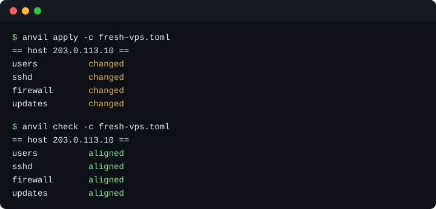

<p align="center"></p>

<p align="center">
  
  
  <a href="LICENSE"></a>
  
</p>

# Fulcrum Anvil

**A fresh VPS to a hardened server in one command, from one TOML file.**

One binary, your own `ssh`, nothing installed on the server. Preview with
`diff`, undo with `rollback`.

<p align="center"></p>

## Quick start

```toml
# harden.toml — each section you add is switched on
[host]
address = "203.0.113.10"
user = "root"

[[users.create]]
name = "admin"
sudo = true
ssh_authorized_keys = ["ssh-ed25519 AAAA… admin@laptop"]

[sshd]
[firewall]
[updates]
```

```bash
cargo install --path .
anvil diff  -c harden.toml    # see what changes
anvil apply -c harden.toml    # make it so
```

## Why it's safe

- **Can't lock you out.** SSH is allowed before the firewall turns on; sshd changes are tested and auto-reverted.
- **Reversible.** `rollback` restores every file it touched.
- **No surprises.** Every remote step is plain bash; `--dry-run` prints it.

## What it does

35 opt-in modules: SSH, firewall, PAM, kernel, auditing and updates up to
**CIS Level 1**, plus Docker or Podman, self-hosted **CI runners in throwaway
sandboxes**, Forgejo, **coding agents** (Claude Code, OpenCode, Orca),
monitoring and backups. [Full list →](docs/04_modules.md)

## Docs

[Tutorial](docs/01_tutorial.md) · [Concepts](docs/02_concepts.md) ·
[Configuration](docs/05_configuration.md) · [Commands](docs/06_commands.md) ·
[Module guides](docs/modules/README.md) · [Plugins](docs/07_plugins.md)

**Status:** 0.1, well tested, young in the field. Read `diff` first.
Apache-2.0.
