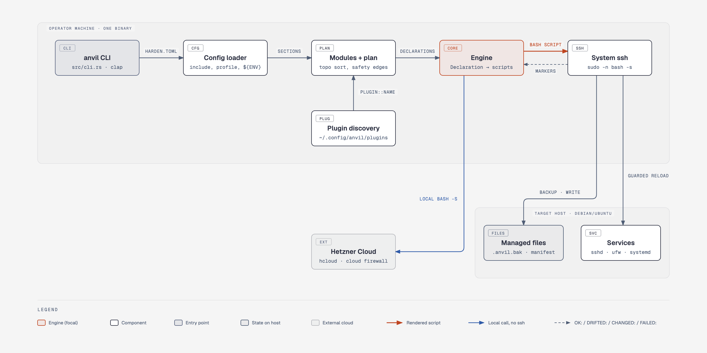
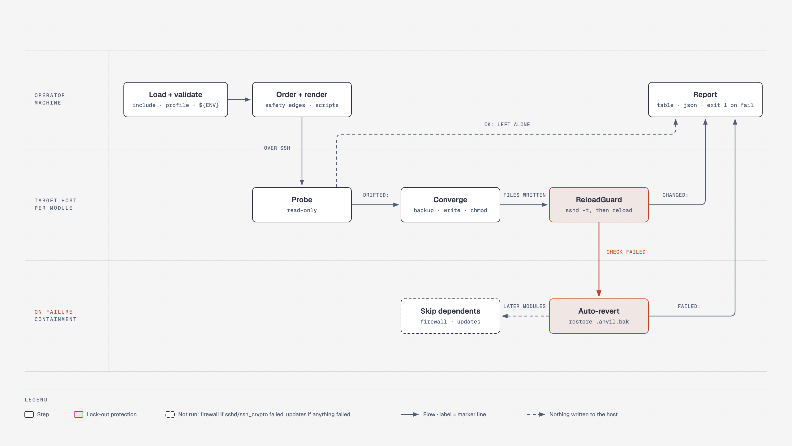
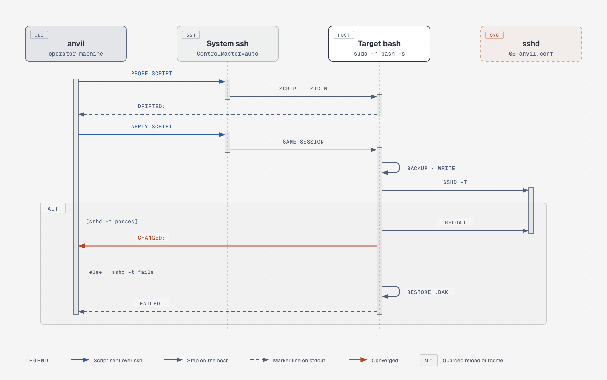
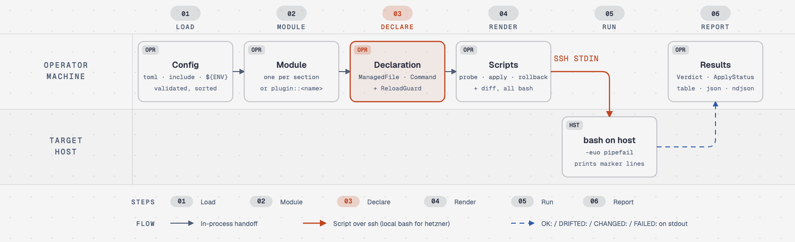
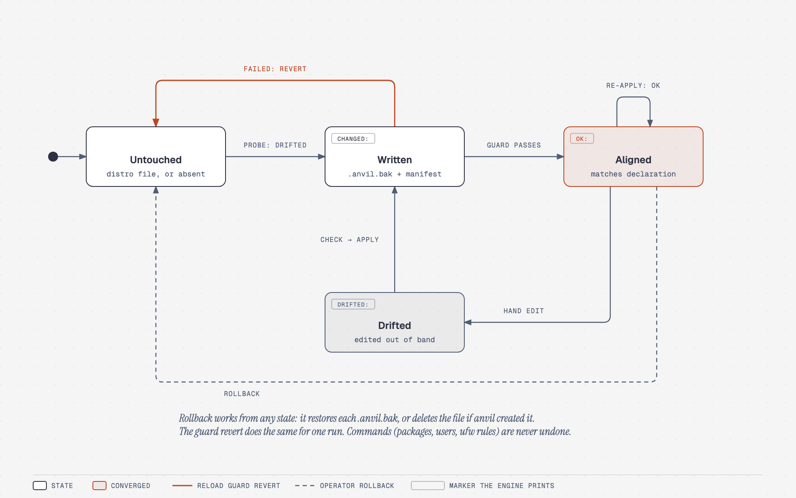

# How anvil works

One binary, one TOML file, one SSH session per host. This page is the map;
[DESIGN.md](../DESIGN.md) is the numbered specification the code is held to.

Every diagram here is a PNG still of a self-contained SVG page in
[`diagrams/`](diagrams/); open the `.html` for a crisp, zoomable version.

## The pieces

[Open full size](diagrams/architecture.html)

| Piece | Code | Does |
|---|---|---|
| CLI | `src/cli.rs` | clap subcommands; renders every script once, fans them out to hosts, prints results |
| Config loader | `src/config/` | resolves `include`, applies `profile`, expands `${ENV}`, deserializes with unknown keys rejected, validates |
| Plugin discovery | `src/plugin.rs` | finds `~/.config/anvil/plugins/<name>/`, applies the trust checks, binds config sections |
| Module registry | `src/modules/` | one `Module` per enabled section; each returns a `Declaration` |
| Plan | `src/order.rs` | topological sort with the safety edges: firewall after sshd, updates last |
| Engine | `src/engine.rs` | renders probe, apply and rollback bash from a `Declaration`; parses the marker lines |
| Transport | `src/ssh.rs`, `src/local.rs` | system `ssh` with ControlMaster, script on stdin, `sudo -n` when not root; plain `bash -s` for the one local module |

Nothing runs on the host but bash under `set -euo pipefail`. The host keeps
the managed files, a `<path>.anvil.bak` beside each one that existed before,
and a per-run manifest under `/var/lib/anvil/runs/`.

## One `apply`

[Open full size](diagrams/apply-workflow.html)

1. Load and validate the config, resolve the run order. A config that
   contradicts a safety edge is rejected here, before any connection.
2. Render every selected module's probe and apply script once.
3. Per host, in order: run the read-only probe. `OK:` means aligned, reported
   as `ok` and left alone. `DRIFTED:` means run the converge script.
4. Converge: back up, write, `chmod`/`chown`, record the manifest. A module
   that reloads a service validates first (`sshd -t`, `nginx -t`, …). A failed
   validation restores the backups it took, deletes the files it created, and
   reports `FAILED:` without reloading.
5. Containment: after an sshd, ssh_crypto or tailscale failure the firewall
   and hetzner are skipped,
   and `updates` runs only after a clean run.
6. Report per host. Exit 1 if anything failed.

`--no-check` skips step 3. `--dry-run` stops after step 2 and prints the
scripts.

## One module over SSH

[Open full size](diagrams/apply-sequence.html)

- The script travels on stdin of one `ssh` invocation; nothing is copied to
  the host first.
- `ControlMaster=auto` and `ControlPersist=60s` keep one TCP and auth session
  per host across the probe and apply passes.
- Non-root logins wrap the script in `sudo -n`, so a missing `NOPASSWD` rule
  fails fast instead of hanging on a prompt.
- `--timeout` SIGKILLs a stalled child and closes the control socket; the
  module is reported failed, the run continues.

## From TOML to host

[Open full size](diagrams/declaration-dataflow.html)

The `Declaration` is the only intermediate form. A module declares:

- `ManagedFile { path, content, mode, owner }`. Content is either exact bytes,
  embedded base64 so the shell never interprets them, or a bash generator run
  on the host when the right answer depends on it (ssh_crypto filters its
  algorithm lists by what the host's OpenSSH supports).
- `ManagedCommand { detect, converge }`. `detect` exits 0 when converged;
  `converge` makes the change.
- an optional `ReloadGuard { validate, reload }`.

From that one value the engine renders the probe, apply and rollback scripts
and computes `diff`. Probe and apply share the same comparison, so they cannot
disagree. Output comes back as `OK:` / `DRIFTED:` / `CHANGED:` / `FAILED:`
lines, parsed once into `Verdict` and `ApplyStatus`, then printed as a table,
JSON or NDJSON.

## A managed file's life

[Open full size](diagrams/managed-file-lifecycle.html)

- First apply: the probe compares content, mode and owner. On drift, an
  existing file is copied to `.anvil.bak`, the new one is written, and the
  manifest records whether it was created or modified.
- Every service reload sits behind a `ReloadGuard`: validate, then reload.
  sshd and ssh_crypto run `sshd -t`, tls `nginx -t`, fail2ban, auditd, docker
  and vector their own config checks, caddy `caddy validate`. On failure every backup taken that run
  is restored and created files are deleted; the service keeps its running
  config.
- `check` reports an out-of-band edit as `DRIFTED:`; the next `apply`
  converges only that.
- `rollback` restores the backup or deletes the file, returning it to
  untouched. Commands are not undone: installed packages, created users and
  ufw rules stay. See [03_operations.md](03_operations.md#rolling-back).
  What each module leaves behind over time:
  [design/host-hygiene.md](design/host-hygiene.md).
