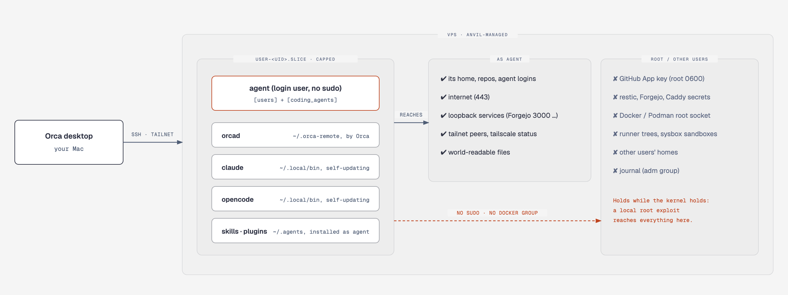

# Design: coding agents on the VPS (`[coding_agents]`)

Status: implemented (live test pending), 2026-11-04. **Verified** = checked against upstream docs,
release assets or this repo (sources in §11). **Assumed** = not yet run on a
host; each one is a line in the live test (§9).



[Open full size](../diagrams/coding-agents-security.html). The agent runs as
one unprivileged login user. Root-only secrets stay out of reach; its own
logins and the network do not.

## Decisions

| # | Question | Decision | Alternatives (rejected) |
|---|---|---|---|
| D1 | Config surface | New section `[coding_agents]` (§1). `deny_unknown_fields` | `[agents]`: ambiguous next to the beszel/vector/runner agents |
| D2 | Which user | One login user (default `agent`) declared in `[users]` with `sudo = false`. No `sudo`, `docker`, `adm` or `systemd-journal` group. Load error otherwise. Containers only rootless, as itself (`docker = "rootless"`, O5) | The login/admin user: it has NOPASSWD sudo (`users.rs`), so a hijacked agent is root. A `nologin` system user: Orca needs SSH and a shell |
| D3 | Claude Code install | **Decided 2026-11-04:** Anthropic's native installer as the agent (`runuser`, `curl -fsSL https://claude.ai/install.sh \| bash -s <channel>`), `stable` channel. Launcher `~/.local/bin/claude` → `~/.local/share/claude/versions/` | Signed apt repo with a pinned key, root-owned `/usr/bin/claude`: no self-update, every update needs root. npm (needs Node 22, same binary) |
| D4 | OpenCode v2 install | **Decided 2026-11-04:** the official v2 installer as the agent (`curl -fsSL https://opencode.ai/v2/install \| bash -s -- [--version X]`), `opencode = "latest"` by default. Binary `~/.opencode/bin/opencode` | Pinned release tarball with SHA-256 per arch, root-owned `/usr/local/bin/opencode`: no self-update. npm `@opencode/cli`: postinstall script |
| D5 | Updates | Both agents update themselves in the agent's home (`claude update`, OpenCode's `update` setting). anvil only checks that each binary runs for the agent and never compares versions, so a self-update is not drift | Root-owned, pinned binaries: no self-update, but every update needs an anvil apply |
| D6 | Node.js | NodeSource apt repo `node_24.x`, key embedded in anvil, pinned above the distro (a distro `nodejs` is upgraded): one root-owned Node 24 in `/usr/bin` for `npx skills` and `npx` MCP servers; context-mode v2 needs ≥ 24.15. Major line fixed, no config field. `apt upgrade` updates it (`[updates]` takes distro origins only). Orca brings its own Node | Distro `nodejs`: 20 on Debian 13, 22 on Ubuntu 26.04. nvm: its `PATH` is invisible to OpenCode's service, MCP servers, Orca and anvil's `npx` runs |
| D7 | Skills and plugins | anvil installs them from lists in `[coding_agents]` (§3), as the agent user, with the same commands a setup repo uses. An optional `setup` runs any setup repo at a pinned 40-hex `rev`. Detect = marker `~/.agents/.anvil-coding-agents` holding a hash of the lists, the `setup` rev and the agent versions, written after a clean run. Re-runs only when it changes | Require a setup repo: ties every user to one repo and its layout. Run on every apply: the installers pull the latest skills each time, so it is never converged |
| D8 | Auth | Not in anvil. One interactive login per agent over SSH (§4). Credentials stay 0600 in the agent's home | `CLAUDE_CODE_OAUTH_TOKEN` / API keys from `${ENV}` in a root-written file: puts a long-lived token in anvil's path for no gain |
| D9 | Orca | SSH target `agent@<tailnet name>`. anvil provides the user, key, shell, build tools and linger; Orca installs its own server in `~/.orca-remote` (§5) | `orca serve` as a systemd unit plus pairing: another listening port and token to manage |
| D10 | Resource caps | `cpu_quota`/`memory_max`/`tasks_max` on the agent's `user-<uid>.slice` (drop-in, path computed on the host like `authorized_keys`) | `[ci_resources]` slice: agents are not CI. Per-terminal caps: Orca's `ORCA_TERMINAL_*` env vars, operator's choice |
| D11 | Network | v1: outbound open, so that `default_outgoing = "deny"` without `proxy` is a load error. Per-uid egress deny-list is a follow-up (§6.2) | Blanket loopback deny for the uid: sshd's port forwarder runs as that uid, so Orca's port forwards break |
| D12 | Dev packages | The module installs only what it needs (`git`, `curl`, `nodejs` from NodeSource with its npm/npx, `build-essential`, `python3`). Toolchains go in `[packages]` or per user (`rustup`, no sudo) | A `toolchains = [...]` field: duplicates `[packages]` |
| D13 | `/tmp noexec` | With `[filesystem] tmp_noexec`, `/etc/profile.d/anvil-coding-agents.sh` sets `TMPDIR=$HOME/.cache/tmp` for this user only (`go test`, npm postinstalls exec from `TMPDIR`) | sshd `Match User … SetEnv`: a Match block in an included drop-in is fragile with first-match-wins ordering |

## 1. Config

```toml
[users]
create = [
  { name = "admin", sudo = true,  ssh_authorized_keys = ["ssh-ed25519 AAAA… admin@laptop"] },
  { name = "agent", shell = "/bin/bash", ssh_authorized_keys = ["ssh-ed25519 AAAA… orca@mac"] },
]

[sshd]
allow_users = ["admin", "agent"]

[coding_agents]
user = "agent"                             # must be a [users] account with sudo = false
claude_code = "stable"                     # "stable" | "latest" | "none"
opencode = "latest"                        # "latest" | a version for the installer | "none"
skills = [
  { source = "cathrynlavery/diagram-design" },                   # every skill in the repo, both agents
  { source = "vercel-labs/skills", names = ["find-skills"] },
  { source = "example-org/claude-skills", agents = ["opencode"] },  # Claude gets it as a plugin
]
claude_marketplaces = ["anthropics/claude-plugins-official"]
claude_plugins = ["playwright@claude-plugins-official"]
opencode_plugins = ["@example-org/example-plugin"]
opencode_mcp = { example-mcp = ["npx", "-y", "example-mcp@latest", "server", "--agent", "opencode"] }
# setup = { url = "https://github.com/owner/setup-repo.git", rev = "<40 hex>", run = "install.sh" }
cpu_quota = "400%"                         # optional caps on everything the user runs
memory_max = "12G"
tasks_max = 4096
```

| Field | Default | Validation |
|---|---|---|
| `user` | `"agent"` | in `[users].create`, `sudo = false`, not `root`/`git`/a runner user; in `[sshd] allow_users` when that list is set |
| `claude_code` | `"stable"` | `stable`, `latest`, `none` |
| `opencode` | `"latest"` | `latest`, `none` or a version for the installer's `--version` (`2.2.5`, `0.0.0-beta-17236`); used when it installs, not enforced after |
| `skills` | `[]` | `source` is `owner/repo` or an https git URL; `names` and `agents` (`claude-code`, `opencode`; default: the installed agents) optional |
| `claude_marketplaces`, `claude_plugins`, `opencode_plugins`, `opencode_mcp` | empty | plugins are `<name>@<marketplace>`; every entry shell-escaped |
| `setup` | unset (skip) | `url` https; `rev` 40 hex (a branch would never converge); `run` a relative path in the repo |
| `cpu_quota`, `memory_max`, `tasks_max` | unset | runner charset, as `runner_common::cgroup_caps` |

Load errors, beyond the table: `[firewall] default_outgoing = "deny"` without
`proxy`; `user` set as a runner's or beszel's docker-group account.

**Outcome on the host** of the example: `agent` (from `[users]`) can SSH in
with the Orca key; `claude` (stable channel) is in `~/.local/bin` and
`opencode` (latest) in `~/.opencode/bin`, both installed and updated by `agent` itself;
`node` 24 (NodeSource) is in `/usr/bin`, root-owned;
`agent` lingers, so its user manager and OpenCode's background server run
without a login; everything it runs shares 4 cores, 12 GB and 4096 tasks;
the listed skills, plugins and MCP server are in its home. Neither agent is logged in
yet (§4).

## 2. What gets installed, as whom, and what rollback removes

| Item | Where | Written by | Rollback |
|---|---|---|---|
| Login user, `authorized_keys` | `/home/agent` | `[users]` (root; already writes `authorized_keys`) | kept: `[users]` never deletes an account or home (it restores `authorized_keys` and sudoers only) |
| Claude Code | `~/.local/bin/claude`, `~/.local/share/claude` | **the agent**, Anthropic's installer (recorded only if anvil ran it) | removed if recorded |
| OpenCode | `~/.opencode/bin`, linked as `~/.local/bin/opencode` (the installer's dir is not on a login PATH) | **the agent**, OpenCode's v2 installer (recorded only if anvil ran it) | removed if recorded |
| NodeSource key, source, pin | `/etc/apt/keyrings/nodesource.asc`, `/etc/apt/sources.list.d/nodesource.list`, `/etc/apt/preferences.d/99-anvil-nodesource` | root, written from content embedded in anvil (same list path as NodeSource's own script: overwritten in place) | removed |
| Node, git, build tools | `nodejs` (NodeSource; replaces distro `npm`), distro packages | root, `apt-get install` | kept (other software may use Node); rollback's `OK:` says so |
| Linger | `/var/lib/systemd/linger/agent` | root, `loginctl enable-linger` | `loginctl disable-linger agent` if anvil enabled it |
| Caps | `/etc/systemd/system/user-<uid>.slice.d/99-anvil-coding-agents.conf` | engine (path computed with `id -u`) | removed, `daemon-reload` |
| `TMPDIR` | `/etc/profile.d/anvil-coding-agents.sh` (only with `tmp_noexec`) | engine | removed |
| Marker, `setup` checkout | `~/.agents/.anvil-coding-agents`, `~/.local/share/anvil/setup` | **the agent user** (`runuser -u agent`) | marker removed; checkout removed |
| Skills, plugins, MCP config, logins, repos, Orca's server | `~/.agents`, `~/.claude`, `~/.config/opencode`, `~/.local/share/opencode`, `~/.orca-remote` | the agent, the installers, Orca | **kept**: they are the user's data. Rollback prints `OK:` naming them and `prune.py` |

Root never writes into the agent's home (a process there could plant a
symlink); the one exception is `[users]`' `authorized_keys`, which predates
this module. Order: the default wave 70 (after `[users]`, `[packages]`, `[firewall]`,
`[tailscale]`); no new safety edge.

## 3. Skills and plugins

- anvil runs, as `agent` with `HOME=/home/agent`, the commands a setup repo's
  `install.sh` uses: `npx -y skills add <source> -g -y -a <agent>…` (with
  `names`, only those skills), `claude plugin marketplace add`,
  `claude plugin install <plugin> -s user`, `opencode plugin add`.
  `opencode_mcp` entries go into `~/.config/opencode/opencode.json` as
  `mcp.<name> = {type = "local", command, enabled}` (python3, other keys kept):
  `opencode mcp add` (2.2.5) writes `mcp.servers.<name>`, which OpenCode v2 ignores.
- `setup`, when set, runs after the lists: `git clone`/`fetch` +
  `checkout --detach <rev>`, then `AGENTS="<installed agents>" ./<run> </dev/null`.
  A setup repo works here unchanged; so does any other repo with a script.
- Any failed item → `FAILED:` with its output; no marker, so the next apply
  retries.
- The marker holds a hash of the lists, the `setup` rev and the
  `claude`/`opencode` versions. A change in any of them re-runs everything
  (each installer is a no-op for what's already there). A newer skill
  upstream is **not** drift. To refresh, `anvil apply --no-check`.
- Lists only add. Removing an entry doesn't uninstall it: the home is the
  agent's (§2); remove by hand or with the setup repo's `prune.py`.
- `npx -y skills`, `claude plugin install` and `opencode plugin add` run
  third-party code as `agent`, with the agent's reach (§6).
- Public sources install on the first apply. A private `setup` repo needs the
  agent's own GitHub credential (§4): the first apply reports
  `DRIFTED: … setup waits for GitHub access` and the next apply after login
  converges.

## 4. Auth

Once per host, by hand, after the first apply:

| Agent | Command | Stored |
|---|---|---|
| Claude Code | `ssh -t agent@host claude`, then `/login` (URL + code, works over SSH) | `~/.claude/.credentials.json` 0600 |
| OpenCode | `ssh -t agent@host opencode`, then `/connect` | under `~/.local/share/opencode` (**Assumed** for v2) |
| GitHub (private `setup` repos, pushes) | `gh auth login` or a fine-grained PAT limited to the agent's repos | the agent's git credential store |

The tokens live only in the agent's home. A hijacked agent can read and
exfiltrate them, so give it its own tokens, scoped to what it needs, never
the owner's admin credentials.

## 5. Orca

Orca reaches the host as an **SSH target** over the tailnet
(`agent@<host>.<tailnet>`, or the Tailscale IP). On first connect it installs
its server (`orcad`, with its own Node) in `~/.orca-remote` over that SSH
connection; worktrees, git and agents then run there as `agent`. Remote
terminals survive the Mac closing. Projects are cloned from the desktop UI or
`orca project setup-clone --host ssh:<id>`.

What the host must provide, and who does it:

| Need | Provided by |
|---|---|
| SSH login with a key, a shell | `[users]` account, `[sshd] allow_users` |
| Reach over the tailnet only | `[tailscale] tailnet_only_ssh = true` (recommended) |
| TCP forwarding (Orca's Ports tab) | anvil's `[sshd]` leaves `AllowTcpForwarding` at its default (yes) |
| Several connections at connect | `ufw limit` (`restrict_ssh`) allows 6 per 30 s per IP; Orca reuses one connection by default. **Assumed** enough |
| Exec in the home (`~/.orca-remote`) | anvil never mounts `/home` `noexec` |
| `make`, a C++ compiler, `python3` (native `node-pty`) | D12 |
| User manager that outlives logout (Orca per-terminal scopes, OpenCode's background server) | linger |

## 6. Security model

**Rule:** an agent with permissions bypassed runs arbitrary code as `agent`,
including code from any prompt injection it reads. Treat `agent` as an
untrusted local user.

### 6.1 What it can and can't reach

| Reaches | Doesn't reach |
|---|---|
| Its home: repos, the agents' logins, its GitHub token, **the agent binaries themselves** (a hijacked agent can replace them; they run only as `agent`) | `sudo`; root-only files: GitHub App key (`/etc/anvil/github-runner/app.pem`, 0600), restic password, Forgejo secrets (0640 `root:git`), Caddy DNS token |
| The internet (needs 443 for both agents, GitHub, npm) | The Docker/Podman root socket (not in `docker`; `docker = "rootless"` gives it its own engine, as itself); sysbox sandboxes |
| Loopback services: Forgejo HTTP 3000, headscale 8080, GreptimeDB, Caddy admin 2019, beszel agent | Other users' homes (`useradd` modes 0700/0750, own group; the live test) and runner trees (0750) |
| Tailnet peers; tailscaled's LocalAPI read-only (status, peer list) | Changing tailscale prefs (needs root/operator) |
| World-readable files, other users' `/proc/<pid>/cmdline` | The journal (not in `adm`/`systemd-journal`) |
| CPU/RAM up to its slice caps | Starving sshd past the caps |

The table holds as long as the kernel does. Only the kernel's resistance to
local privilege escalation separates `agent` from root, and so from the App
key; there is no sandbox.

### 6.2 Next to CI runners and Forgejo

| Neighbour | Why it stays true |
|---|---|
| `[github_runner]` v1/v2, `[forgejo_runner]` | Separate system users with 0750 trees, hardened units, `ci.slice`. `agent` is not in `docker`, so it can't reach v1 `docker = "group"` containers or v2 sandboxes. Load error if `user` is a runner user |
| GitHub App key (on the runner host) | root 0600; `agent` has no sudo. A kernel LPE from the agent registers runners for the org: see O2 |
| Forgejo | Its secrets are root/git-only. Its HTTP on 127.0.0.1:3000 is reachable without TLS: an agent can log in like any client, but only with credentials it has |
| CrowdSec, ufw | Unchanged; the agent adds no listener |

Follow-up (checklist): an nftables table `anvil_coding_agents` with
`meta skuid <uid>` rejects to tailnet (`100.64.0.0/10`, `fd7a:115c:a1e0::/48`),
RFC 1918, link-local/metadata, and the loopback ports anvil itself configured
(Forgejo, headscale, GreptimeDB, Caddy admin, beszel). Other loopback ports
stay open, so Orca's forwards to dev servers keep working. A separate table
coexists with ufw's iptables-nft rules and CrowdSec's own tables.

## 7. Checks the module does

- `check`: `claude --version` and `opencode --version` run as the agent (no
  version compare: both self-update), linger, caps drop-in, marker. Never
  logs in.
- The CLI shows only each module's status and first `FAILED:` line: the
  `setup waits for GitHub access` line and rollback's `OK:` naming the kept
  home are in the script output; `check` keeps reporting the missing marker.
- `diff`: the profile script and caps drop-in are `ManagedFile`s, so they
  show as diffs.

## 8. Owner decisions

| # | Decision | Recommendation |
|---|---|---|
| O1 | Depend on a setup repo? | **Decided 2026-11-04:** no. anvil installs from its own lists (D7); a setup repo is an optional `setup` |
| O2 | Agents next to the GitHub App key? | **Decided 2026-11-04:** agents run next to the GitHub runners. Co-location accepted with the risk as written: a kernel LPE from a prompt-injected agent equals org-wide runner registration |
| O3 | Claude channel | **Decided 2026-11-04:** `claude_code` default `stable` (the installer's channel) |
| O4 | How do the agents update? | **Decided 2026-11-04:** they self-update, from their native installers in the agent's home (D3, D4, D5); no apt, no unattended-upgrades |
| O5 | Rootless Podman for the agent (containers in dev work) | **Decided 2026-11-04:** later, as a field, not in the first PR; Docker group is refused. **Done 2026-11-08:** `docker = "rootless"`, the host's engine as the agent (rootless dockerd or rootless Podman), with `DOCKER_HOST` in its logins and Orca. An escape lands as `agent`; the added risk is user-namespace kernel surface (a kernel LPE was already the path to root, §6.1). Not sysbox/gVisor: the agent itself runs unsandboxed on the host, so a stronger wall around its containers would not close that path |

## 9. Live test (fresh Hetzner box)

Debian 13, then Ubuntu 26.04, rebuilt between rounds and deleted at the end.
Config: §1 plus `[firewall]`, `[filesystem] tmp_noexec`, `[tailscale]
tailnet_only_ssh`, `[github_runner]` v1 (co-location).

| # | Check |
|---|---|
| 1 | Apply on a fresh box; second apply is a no-op (`OK:` only) |
| 2 | `node --version` ≥ 24.15 from NodeSource for `agent`; context-mode's `ctx_doctor` passes `D2 node`. `claude --version` runs for `agent` from `~/.local/bin`, at the stable channel's version at install time; no `claude-code` apt package |
| 3 | `opencode --version` runs for `agent` from `~/.local/bin` (link to `~/.opencode/bin`), also in a login shell |
| 4 | Both self-update as `agent` (`claude update`; OpenCode `update = "auto"`) and the next `check` stays aligned (**Assumed**) |
| 5 | Logins over `ssh -t` work for both agents; credentials 0600 in the home |
| 6 | Orca: add SSH target over the tailnet, clone a repo, worktree with `claude`, one with `opencode`; a terminal and a `claude` launched from Orca's chat surface both see `TMPDIR` (profile.d runs only in login shells; fallback: sshd `Match User`); `go test`/`npm ci` work with `/tmp` `noexec`; Ports tab forwards a dev server; `ufw limit` doesn't throttle connect |
| 7 | Lists: skills in `~/.agents/skills` (OpenCode-only entry not in `~/.claude/skills`), plugin in `claude plugin list`, ponytail and context-mode MCP in OpenCode; marker written; re-apply doesn't re-run; editing a list does. Then `setup` = a setup repo at a pinned rev on top: converges, bumping `rev` re-runs |
| 8 | As `agent`: `sudo -n true` fails; can't read the runner's `.credentials`, `/etc/anvil`, other homes, `/var/run/docker.sock`; `journalctl` shows nothing |
| 9 | Caps: `systemctl show user-<uid>.slice` has the limits; a fork bomb stops at `tasks_max`, sshd stays responsive |
| 10 | Rollback: the installers' files (`~/.local/bin/claude`, `~/.local/share/claude`, `~/.opencode/bin`, `~/.local/bin/opencode`), linger, drop-ins gone; `~/.claude`, OpenCode config/data and the rest of the home kept; the `OK:` names them |

## 10. Implementation checklist

- [x] `CodingAgentsSection` in `schema.rs` (D1, §1), validation in `config/mod.rs` (user in `[users]` without sudo, `allow_users`, runner/docker users, `default_outgoing`, rev/hash formats)
- [x] `src/modules/coding_agents.rs`: deps packages; Node 24 from NodeSource; Claude Code and OpenCode from their official installers as the agent; linger; caps drop-in (computed path); `TMPDIR` profile script; lists install, `setup` clone/run and marker as `runuser -u <user>`; rollback per §2
- [x] Register in `modules/mod.rs`, default wave in `order.rs`, add to `FULL_EXTRA` in `cli.rs`
- [x] Unit tests: escaping of list entries, `url`/`rev`/`run`/user, root never writes under the home (everything there via `runuser`), marker only after success, rollback keeps the home; `tests/cli.rs` for the load errors
- [x] Operator guide `docs/modules/coding-agents.md` (login steps, Orca setup); README module list
- [ ] Live test §9 on Hetzner (both distros)
- [ ] Follow-up: per-uid nftables egress deny-list (§6.2)
- [x] Owner decisions O2–O5
- [ ] `scripts/acceptance.sh --coding-agents` on a disposable Ubuntu 26.04 box

## 11. Sources (verified 2026-11-04)

- Claude Code native install (`install.sh [stable|latest|VERSION]`, launcher `~/.local/bin/claude`, versions in `~/.local/share/claude`), updates, uninstall: https://code.claude.com/docs/en/setup
- Claude Code auth, `.credentials.json`, `setup-token`, `CLAUDE_CODE_OAUTH_TOKEN`: https://code.claude.com/docs/en/authentication
- Claude channels: https://downloads.claude.ai/claude-code-releases/stable (2.1.311), `/latest` (2.1.318)
- OpenCode v2 install and CLI (background service, `uninstall`): https://opencode.ai/v2/docs/ , https://opencode.ai/v2/docs/cli/ , script https://opencode.ai/v2/install
- OpenCode v2 config (`update`: `disable`/`notify`/`auto`, default `notify`): https://opencode.ai/v2/docs/config/
- OpenCode v1/v2 can't share the `opencode` command: https://opencode.ai/docs/
- OpenCode v2 installer (`--version`, `--no-modify-path`, installs `~/.opencode/bin/opencode` and an `opencode2` shim): https://opencode.ai/v2/install
- Orca SSH worktrees (server in `~/.orca-remote`, node-pty build tools, forwarding, reuse): https://github.com/stablyai/orca/blob/main/docs/site/content/docs/ssh.mdx
- Orca SSH host recipe (login by hand over `ssh -t`): https://github.com/stablyai/orca/blob/main/skill-guides/orca-per-workspace-env/references/ssh-host.md
- setup repo example: https://github.com/owner/setup-repo (`install.sh`, `prune.py`, `*.txt`: the command shapes in §3)
- NodeSource (2026-11-06): https://github.com/nodesource/distributions; key https://deb.nodesource.com/gpgkey/nodesource-repo.gpg.key; suite `nodistro`, amd64/arm64
- context-mode v2 (`context-mode@next`): `engines.node` `>=24.15.0`; below it, only `ctx_doctor` is exposed
