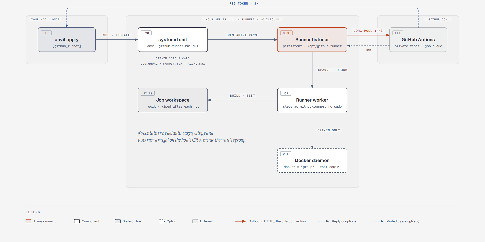
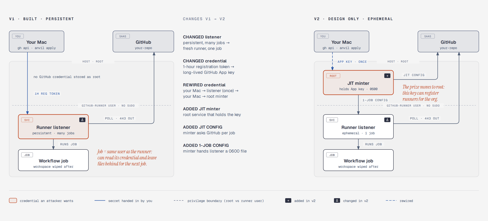
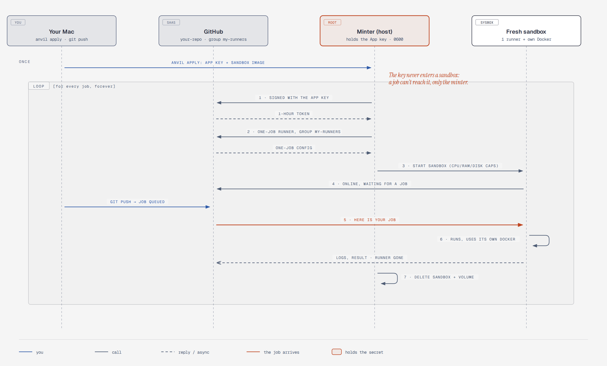

# Design: self-hosted GitHub Actions runners (`[github_runner]`)

Status (2026-11-02): **v1 is live-tested**. **v2**
(ephemeral runner in a sysbox sandbox per job) is built (§4), live test
pending.
**A public repo runs its CI on GitHub-hosted runners only; the runner group
stays closed to public repos.** Earlier versions of this document are in git history. **Operators:** setup, limits and troubleshooting
are in [the runner guide](../modules/github-runner.md); this is the decision record.

[Open full size](../diagrams/github-runner-flow.html). How v1 runs on the host.

[Open full size](../diagrams/github-runner-security.html). Where the
credentials live in v1 and v2, and what a hostile job can reach.

[Open full size](../diagrams/github-runner-v2.html). Why v2 needs the GitHub App: the
minter uses its key to get a fresh one-job runner for every job.

## 1. What v1 is

One or more **persistent** runners per host. Each one is registered once
and then takes job after job.

| Piece | What anvil does | Code |
|---|---|---|
| Install | Downloads the pinned `actions/runner` tarball (v2.338.2), checks the SHA-256 anvil ships per architecture, and extracts it as `github-runner` into `/opt/github-runner/<name>` | `github_runner.rs`, `runner_common.rs` |
| Dependencies | Runs upstream's `installdependencies.sh` from the verified, root-only temp copy, only if a library is missing | `github_runner.rs` |
| User | System user `github-runner`, `nologin`, not in `sudo`; only in `docker` with `docker = "group"` | `runner_common.rs` |
| Register | `config.sh --unattended --replace` as `github-runner`, token passed as `ACTIONS_RUNNER_INPUT_TOKEN` (never argv). Drift = anvil's `.anvil-registration` marker (url, name, labels, group, disableupdate) | `github_runner.rs` |
| Service | anvil-owned unit `anvil-github-runner-<name>.service` (no `svc.sh`): `NoNewPrivileges`, `ProtectSystem=strict`, `ProtectHome`, `PrivateTmp`, `PrivateDevices`, empty `CapabilityBoundingSet=` (no capabilities, even for a job that became root), `RestrictSUIDSGID`, kernel/cgroup protections, `OOMPolicy=continue` (an OOM-killed job doesn't stop the runner), optional `CPUQuota`/`MemoryMax`/`TasksMax`. Own `HOME=/var/lib/github-runner/<name>`; `ReadWritePaths` = its dir and home only. Apply restarts a runner only when its own unit, hook, mount or registration changed | `runner_common::unit` |
| Workspace | Job-completed hook wipes checkouts and keeps the `_actions`/`_tool` caches, then deletes the runner user's entries in the unit's private `/tmp` and `/var/tmp`, which otherwise live as long as the service. A job-started hook sets `TMPDIR=$RUNNER_TEMP` (CIS `/tmp` is `noexec`). Hooks and proxy live in the root-owned unit, not in the runner dir | `github_runner.rs` |
| Updates | `auto_update = true` (default): the runner updates itself; anvil's pin is the floor. `false` = `--disableupdate`, and you must re-apply within 30 days | `github_runner.rs` |
| Disk (GR23) | `disk_max`: per-runner sparse ext4 image in `/var/lib/anvil-ci`, `mkfs` with the runner as root owner, loop-mounted `nodev,nosuid` on `_work` by `opt-github\x2drunner-<name>-_work.mount`; the service has `RequiresMountsFor=` on it. Never resized (`FAILED:` on a size change); `check` drifts at 90% full. A daily `anvil-github-runner-prune.timer` (as `github-runner`, `ReadWritePaths=/opt/github-runner`) deletes `_diag/*.log` older than `diag_retention_days` (14) and, when capped, wipes `_tool`/`_actions` past half of `disk_max` while no `Runner.Worker` runs. Rollback stops timer and mounts first, deletes the image only if anvil created it. The image is sparse: the cap holds only while `/` has room for it. Docker data (`/var/lib/docker`, v2 sandbox volumes) is not capped yet | `github_runner.rs` |
| needrestart | Drop-in so unattended upgrades don't restart the runner mid-job | `github_runner.rs` |
| Firewall | Load error if `[firewall] default_outgoing = "deny"` without `proxy` (needs outbound 443, nothing inbound) | `config/mod.rs` |
| Rollback | Stop unit, `config.sh remove` if `remove_token` is set (else an `OK:` warning: GitHub drops offline runners after 14 days), delete the tree only if anvil marked it and the home only if anvil created it, remove the user only if anvil created it | `github_runner.rs` |
| Order | Wave 58 (after `docker`/`containers`), no hard edge | `order.rs` |

Root never writes into the runner dir (a job could plant a symlink there):
extraction and markers run as `github-runner`.

## 2. Config

Example config, token command and `runs-on`: [runner guide](../modules/github-runner.md#v1-quick-start).

## 3. Security model

**Rule:** a self-hosted runner runs whatever code a workflow contains, as
`github-runner`, on the host. Whoever can trigger a workflow on that repo
can run code on the box.

| Risk | v1 | v2 |
|---|---|---|
| Fork pull requests run code on the host | Not protected by anvil. Private repos only; a public repo runs its CI on GitHub-hosted runners and the runner group stays closed to it | Same |
| A job reads the runner's own credential (`.credentials`) | Yes, same user. It can impersonate that one runner until removed | Credential is valid for one job only |
| A job leaves files behind for the next job (persistence) | Workspace, `/tmp` and `/var/tmp` are wiped after each job. The runner dir stays writable (self-update), so a hostile job can still plant files there | Gone: every job gets a fresh sandbox |
| Long-lived GitHub secret on the box | **None.** The 1-hour token is used once and not stored | **Yes:** a GitHub App private key, root-only 0600. A job that escapes to root can register runners for the whole org |
| Job becomes root | Only via a kernel bug: no sudo (`NoNewPrivileges`), no capabilities (`CapabilityBoundingSet=`), read-only system. Or by design with `docker = "group"` | Docker runs inside the sandbox; its root is an unprivileged uid on the host |

### What "App key on the box" means (v2)

anvil runs once and exits; it cannot hand out a new runner for each job. For
ephemeral runners **something on the host** must ask GitHub for a fresh
one-job runner config (`generate-jitconfig`) before every job. That call
needs a long-lived credential: a **GitHub App private key** (or a PAT). It
would sit in `/etc/anvil/github-runner/app.pem`, root-only, read by a root
`ExecStartPre` that writes a one-job config for the runner user.

The trade: v2 removes persistence between jobs, but adds a key that never
expires and can create runners in the org. v1 keeps nothing valuable on the
box. For a private repo where only trusted people push, v1 is GitHub's
documented baseline. v2 pays off with untrusted or many contributors, and
only together with a sandbox per job (otherwise a job could read the key).

## 4. Plan (decided 2026-11-02)

| | v1 `mode = "persistent"` (default, built) | v2 `mode = "ephemeral"` |
|---|---|---|
| For | Private repos, trusted pushers, no Docker | Docker jobs; the repo once public |
| Docker | `none`, or `group` (jobs are root on the host) | Own Docker inside a **sysbox** sandbox per job (spike: works on Debian 13 / kernel 6.12; gVisor not needed) |
| Credential on the host | none | GitHub App key, root-only, outside every sandbox |
| Limits | `[ci_resources]` slice + per-runner caps, `disk_max` | Same; each sandbox gets `--cgroup-parent=ci.slice` and its own capped storage, removed with its volumes |
| Runtime | — | `sandbox_runtime = "sysbox-runc"` (only value). `"podman"` for Podman-only hosts: spike green on Debian 13 + Ubuntu 26.04, not built yet; Ubuntu needs an AppArmor profile. A later `"kata"` (needs `/dev/kvm`) adds its own install and one allowed value |

Rootless Docker for the runner user was first dropped: blocked upstream
(an actions/runner bug) and in conflict with `NoNewPrivileges`. The
Podman runner later dropped `NoNewPrivileges` for its rootless engine,
so v1 now has `docker = "rootless"` (2026-11-08): a rootless dockerd inside the
unit the same way. That upstream bug still holds: job containers get the root socket
mounted, which the runner's uid cannot open, so Docker inside a container job
needs v2. The other upstream limitation (non-root images can't write the workspace) is accepted, as
for Podman.

### v2 on the host

Code: `github_runner_ephemeral.rs`; operator view in the
[guide](../modules/github-runner.md#v2-ephemeral-runners-mode--ephemeral).

- **`daemon.json`:** v2 owns it (not `[docker]`) because the engine writes
  files after commands: anvil's file lands after the sysbox postinst edits it.
- **Sandbox image:** the base image already ships the static Docker
  bundle (dockerd, containerd, runc), so anvil adds only `iptables` and
  `sandbox_packages` (both in the content-hashed tag); Ubuntu `docker.io`
  would collide with it. The JIT config reaches the runner as
  `ACTIONS_RUNNER_INPUT_JITCONFIG`, never argv (host `ps` sees sandbox argv).
  `ACTIONS_RUNNER_PRINT_LOG_TO_STDOUT=0` overrides the base image's `1`, so
  the journal gets terminal lines, not the trace.
- **Labels:** `generate-jitconfig` adds no defaults, so the minter sends
  `self-hosted`, `Linux` and the `uname -m` arch label with the configured
  ones (case-insensitively deduplicated), as `config.sh` does.
- **Secrets:** JWT and installation token go to curl on stdin (`-K -`); the
  JIT config via a 0600 env file in `/run`, deleted right after `docker create`.
- **Storage:** one sparse ext4 image per slot, `mkfs` before every job (also
  returns the space), holding the sandbox's `/var/lib/docker` and `_work`.
  The minter mounts it, so its unit has no mount namespacing.
- **Loop:** each job is a `once` child process (so `set -e` holds); errors
  back off 10 s → 10 min; `ExecStopPost` removes the sandbox (`rm -fv`,
  spike's 338 MB leak) and unmounts.

## 5. Forgejo

`[forgejo_runner]` shares `runner_common.rs` (user, verified download,
hardened unit, cgroup caps). Its live test runs after a Forgejo exists.

## 6. CI resource share (`[ci_resources]`)

`[ci_resources]` writes `/etc/systemd/system/ci.slice` (`CPUQuota=`,
`MemoryMax=`, `TasksMax=`, `CPUWeight=`, default weight 50) and puts every
runner unit in it with `Slice=ci.slice` (systemd adds `Requires=` and
`After=` on the slice by itself). The name has no dash, so systemd makes it a
direct child of `-.slice`, a sibling of `system.slice`/`user.slice`, where
its own weight counts. The slice is the total CI share of the
host; each runner's own `cpu_quota`/`memory_max`/`tasks_max` still apply
inside it. A `CPUWeight` below the default 100 keeps sshd and other system
services ahead under contention. It runs before the runners (hard edge);
changing a limit is a `daemon-reload`, never a slice restart. Rollback
removes the slice file and restores the older `anvil-ci.slice` and its
`anvil.slice` drop-in if the host had them; the runner units drop `Slice=`
with their own unit files (on rollback or on the next apply without the
section).

| | v1 (`docker = "group"`) | v2 |
|---|---|---|
| Runner process and host-label jobs | in the slice | in the slice |
| Job containers | started by dockerd, so in **dockerd's cgroup**: not capped by the slice or the runner's caps. Every command warns when both are set | each sandbox starts with `--cgroup-parent=ci.slice`, so it is capped |

## 7. Sources (verified 2026-10-31)

- Releases / checksums: https://github.com/actions/runner/releases/tag/v2.338.2
- Requirements, updates, ephemeral, labels: https://docs.github.com/en/actions/reference/runners/self-hosted-runners
- REST tokens, JIT: https://docs.github.com/en/rest/actions/self-hosted-runners
- Hardening: https://docs.github.com/en/actions/reference/security/secure-use
- Hooks: https://docs.github.com/en/actions/how-tos/manage-runners/self-hosted-runners/run-scripts
- Docker group: https://docs.docker.com/engine/install/linux-postinstall/
- Upstream source: `src/Runner.Common/Constants.cs`, `src/Misc/layoutbin/installdependencies.sh` in actions/runner
