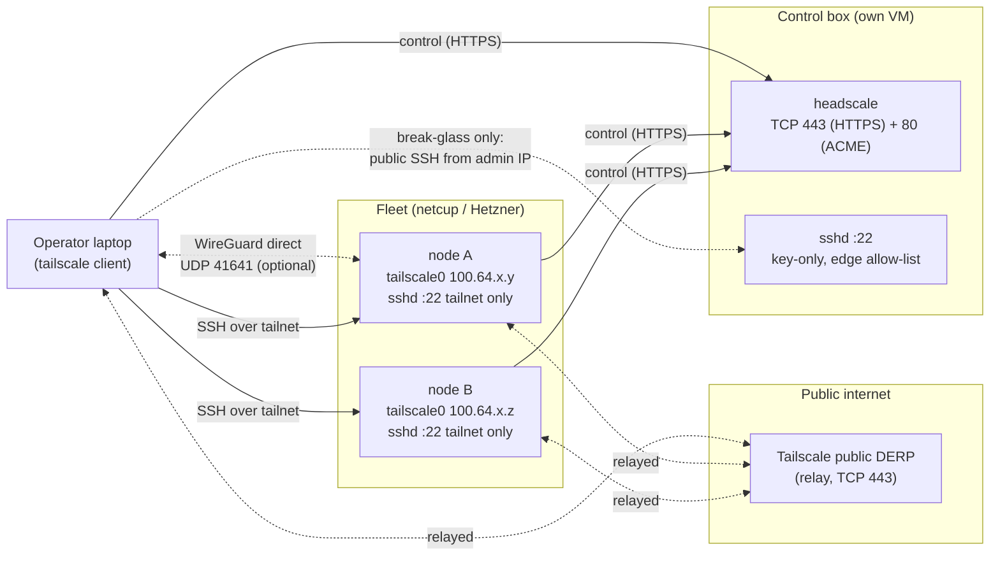

# Design: Tailscale / Headscale in Fulcrum Anvil

Status: **decided 2026-10-31** — Tailscale SaaS now, Headscale later. See "Decision" below; the study that led there follows unchanged.

## Decision (2026-10-31)

- **Control plane: Tailscale SaaS**, `login_server` empty. Headscale stays the option for when the fleet grows (§2); plain WireGuard was the zero-dependency alternative considered for a single server.
- **Fixed on the way:** under the CIS `umask 027` the Tailscale apt key landed 0640 and Debian 13's apt (`sqv` as `_apt`) could not read it (`75809c2`, also for `vector`).
- **In review:** T1 (tighten only when SSH arrives over the tailnet) and T9 plus the crowdsec equivalent (never ban tailnet IPs). The reachability check is host-side (`ss` vs `tailscale ip`), so no new config field such as `tailnet_only_ssh_confirm` is needed.

## TL;DR

- **Goal:** SSH to every server only over a private WireGuard network (a "tailnet"). Public port 22 closes.
- **Today:** anvil can join a node to a tailnet and, with `tailnet_only_ssh = true`, drop the public SSH rule. But it decides "safe to tighten" by checking only that *the node has a tailnet IP*. It never checks that *the operator can reach the node over the tailnet*. That is the lockout risk this design fixes first.
- **Recommend:**
  1. Run Headscale on its **own small box**, *not* tailnet-only (so you can still reach it if the tailnet is broken).
  2. Join servers with **one-off, tagged, non-ephemeral** pre-auth keys, passed as `${ENV}`.
  3. Use **Tailscale's public DERP** relays for v1.
  4. Gate `tailnet_only_ssh` on a **verified tailnet session**, not just a tailnet IP.
  5. Close public 22 at the **provider edge** too, only after the tailnet path is proven.
  6. Keep a **break-glass** path: provider console plus a documented, time-boxed edge rule.
- **Not recommended now:** Headplane (web UI). It mounts the Docker socket (`headscale.rs:38`, `:250`), which is effectively root on the host.

## 1. How it works today

### `[tailscale]` (`src/modules/tailscale.rs`, `docs/05_configuration.md:306`)

| Field | Effect | Where |
|---|---|---|
| `login_server` | `tailscale up --login-server` | `tailscale.rs:64-72` |
| `auth_key` | `tailscale up --auth-key`; read from `${TAILSCALE_AUTH_KEY}` per `docs/05_configuration.md:47` | `tailscale.rs:73-75` |
| `hostname`, `accept_routes` | passed to `tailscale up` | `tailscale.rs:76-83` |
| `tailnet_only_ssh` | adds a 3rd command that re-scopes SSH to `tailscale0` | `tailscale.rs:159-163`, `:107-147` |

Commands it runs on the host:

1. Install from the pinned `pkgs.tailscale.com` apt repo, `signed-by=` keyring (`tailscale.rs:40-55`). Good: no `curl | sh`.
2. `tailscale up …`. Detect is `tailscale status` **plus** a `tailscale debug prefs` grep for the configured `ControlURL` (`tailscale.rs:87-93`). This catches a node joined to the wrong server.
3. (opt-in) `tailnet_only_ssh`: if `tailscale ip -4` returns an address, add `ufw allow in on tailscale0 … port N` and delete the world `allow`/`limit` rules. Otherwise print "tailnet not confirmed up" and change nothing (`tailscale.rs:131-137`).

### Gaps and risks

1. **"Up" is not "reachable".** The gate at `tailscale.rs:118`/`:131` is `tailscale ip -4` non-empty. That is true as soon as the node has joined, even if:
   - the operator's laptop is not on the tailnet,
   - an ACL denies the operator,
   - the coordination server is unreachable from the operator.

   The world rule is then deleted and new public SSH connections fail. Established sessions survive (ufw's conntrack accept), but the next login does not. This is the largest risk in the current code.
2. **No rollback for tailscale.** The declaration has no `rollback_script` (`tailscale.rs:155-165`). `rollback --only tailscale` does nothing. A full rollback re-opens SSH only because firewall's rollback re-allows the restored `sshd -T` port. That is a side effect, not a design. Also `docs/03_operations.md` says commands are not undone.
3. **Node stays joined after rollback.** Nothing logs the node out or removes it from the tailnet.
4. **(Fixed: now `--auth-key file:…`.) `auth_key` was a one-shot secret in `tailscale up` args**, visible in process listings on the host while it runs. The value is single-quoted via `shell_escape` (good), but it is still on the command line.
5. **fail2ban has no tailnet exemption.** `src/modules/fail2ban.rs` has no `ignoreip` at all. After cutover, every SSH attempt comes from a `100.64.0.0/10` address, and repeated typos can ban the operator's tailnet IP.
6. **hetzner keeps public SSH open forever.** `ssh_guard_rule` always adds `0.0.0.0/0,::/0` (`hetzner.rs:64-72`) to satisfy R61. That contradicts tailnet-only at the cloud edge.

### `[headscale]` (`src/modules/headscale.rs`, `docs/05_configuration.md:292`)

What it does:

- Installs a pinned `headscale` `.deb` by arch (`headscale.rs:265-289`). Default `version` is `0.23.0` (`src/config/schema.rs`, `HeadscaleSection`).
- Writes `/etc/headscale/config.yaml` (`headscale.rs:100-130`), a systemd unit (`:133-153`), and an optional inline ACL (`acl.hujson`, `:70-96`, `:406-408`).
- Runs `headscale users create` and `headscale preauthkeys create` from `auth_keys`, and stores each key in `/var/lib/headscale/preauth-<name>.key` (`:356`, `:364-365`).
- Optional Headplane web UI as a Docker container (`:231-260`).

Gaps and risks:

1. **No TLS.** `listen_addr` defaults to plain `0.0.0.0:8080` (`schema.rs` defaults). The generated config has no ACME or cert keys (`headscale.rs:100-130`). Clients need HTTPS, so something else must front it. The `tls` module is nginx-based and its own docs say it "needs a domain" (`scripts/smoke.sh:206`), so it is not wired for this.
2. **Keys go stale.** The marker `[ -s preauth-<name>.key ]` (`headscale.rs:364`) means a key is created once with `expiration = "24h"` (schema default) and never refreshed. Nothing copies it to the operator, so the bridge to `auth_key` is manual.
3. **No tags or ephemeral flag.** `AuthKeySpec` has only `name`, `reusable`, `expiration` (`schema.rs`, `AuthKeySpec`). Tag-based ACLs cannot be expressed through anvil.
4. **Headplane exposes the Docker socket and port 3000.** The container mounts `/var/run/docker.sock` (`headscale.rs:38`, `:250`), and the default listen is `0.0.0.0:3000` (`schema.rs`, `:457`). Anvil does not open 3000 in ufw, but any future rule would expose it.
5. **`base_domain: headscale.internal` is hardcoded** (`headscale.rs:123`).
6. **Version drift.** The default pin is old, and the headscale CLI has changed across releases (namespaces became users). Verify before bumping (see §8).

### Ordering today (`src/order.rs`)

| Module | Wave | Source |
|---|---|---|
| `sshd` | 20 | `order.rs:19` |
| `firewall` | 50 | `order.rs:31` |
| `tls` | 56 | `order.rs:33` |
| `headscale` | 60 | `order.rs:34` |
| `tailscale` | 61 | `order.rs:35` |
| `hetzner` | 65 | `order.rs:38` |
| `updates` | 100 (last) | `order.rs:40` |

Hard edges (`order.rs:84-86`): `sshd → firewall`, `sshd → ssh_crypto`, `ssh_crypto → firewall`, and `updates` last.

- **`firewall` (50) before `tailscale` (61) is correct and should stay.** Firewall opens SSH world-wide *before* enabling ufw (`firewall.rs:124-172`). Tailscale narrows it later. Flipping them would enable ufw with no SSH rule.
- **`headscale` (60) before `tailscale` (61)** is only a wave ordering, with no hard edge. It matters only when both run on one host, which is not the target design.
- **No edge between `tailscale` and `hetzner`.** Hetzner's guard always keeps 22 open, so order does not matter today. That changes once tailnet-only is the goal (§6).
- **Safety skip:** `cli.rs:716-735` skips `firewall`/`hetzner` after a failed `sshd`/`ssh_crypto`. It does **not** skip `tailscale` after a failure. A failed tailscale step can therefore still run `tailnet_only_ssh` in a later sub-step — but it only changes ufw when the tailnet is confirmed up, so this is a gap to close (§3).

## 2. Target architecture

### Where Headscale runs

| Option | Pro | Con |
|---|---|---|
| **A. Own small box (recommended)** | Fleet can be tailnet-only without making the control plane depend on itself. Its SSH stays public and key-only, behind an edge allow-list. | One more box to run and patch. |
| B. On one fleet server | No extra box. | If that server is down or being re-cut, the whole tailnet is stuck. Circular: the server you fix through the tailnet is also the one that hosts the control plane. |
| C. Tailscale SaaS (no Headscale) | Managed control plane, DERP, DNS, SSO. | Third-party control plane; the account must be trusted. No sovereignty. Anvil's `tailscale` module already works with it (leave `login_server` empty). |

**Recommendation: A.** The Headscale box is the one host that must stay reachable with no tailnet. It should not have `tailnet_only_ssh`.

### Topology



Key point: once tailnet-only, SSH never reaches the node's **public** address. It arrives inside WireGuard on `tailscale0`. The provider edge only sees WireGuard/DERP traffic.

### Joining nodes

- **Pre-auth keys**, one-off per host, **tagged** (`tag:server`), **non-ephemeral** (servers persist), short expiry (e.g. `1h`). Tailscale's docs: one-off keys connect one device once; tagged keys give the device the key's tags; if no expiry is set the key lasts up to 90 days (tailscale.com/kb/1085/auth-keys).
- **Reusable keys** only for bulk bootstrap, and then only from a secrets manager. The Tailscale docs call them "very dangerous if stolen".
- **Ephemeral** is for containers/CI, not for servers.
- The key lives in the operator's environment, never in the repo (see §3, secrets).

### DERP (relay)

- DERP is Tailscale's fallback relay. Traffic is WireGuard-encrypted end to end; DERP only forwards (tailscale.com/kb/1232/derp-servers).
- Connection order: direct → peer relay (optional) → DERP (last resort).
- **v1 recommendation: keep Tailscale's public DERP.** Servers with public IPs usually connect directly. Self-hosted DERP adds a box, a region, and an exposure to run.
- Self-hosted DERP is possible (tailscale.com "custom DERP servers"; Headscale reads a DERP map via `derp_map_path`). Not designed here; leave as a later option.
- If the control plane is down, clients keep their last-known DERP list (Tailscale KB). Existing nodes keep relaying; new joins fail.

### MagicDNS

- Lets you use `node-name` instead of `100.x.y.z`. Anvil's `base_domain: headscale.internal` is hardcoded (§1). Make it a config field, and pick a domain you control (not a public TLD you do not own).
- Anvil's own SSH should use the MagicDNS name or the tailnet IP, stored in `[host] address`.

### ACL / policy

Headscale uses Tailscale's huJSON policy. **No policy means allow-all** (headscale.net policy docs, verified). Grants are recommended over ACLs by Tailscale; ACLs are still supported. Example (ACL form, simplest to read):

```jsonc
{
  "tagOwners": { "tag:server": ["group:ops"] },
  "groups":    { "group:ops": ["ops@example.net"] },   // placeholder headscale user
  "acls": [
    { "action": "accept", "src": ["group:ops"], "dst": ["tag:server:22"] }
  ]
  // no other rules: everything else is denied when a policy is present
}
```

Notes:

- Writing *any* policy file with no matching rule denies. Keep the operator's own node in `group:ops` before enabling tailnet-only, or you lock yourself out of the tailnet.
- Treat the `user` names as headscale users. Check the exact identity field for your headscale version before relying on it (§8).

### Tailscale SaaS vs Headscale

| | Tailscale SaaS | Headscale (self-hosted) |
|---|---|---|
| Control plane | Tailscale runs it | You run it (one more box to patch) |
| Trust | Trust Tailscale with metadata and key handling | Trust yourself |
| SSO, admin UI | Yes | Headplane (optional, see §1), CLI otherwise |
| Anvil fit | `login_server` empty; works today | `login_server` = your URL; needs TLS and version care |
| Failure mode | Tailscale outage | Your box down |
| Features | Full (Grants, Tailscale SSH, Funnel, etc.) | Subset; check Headscale's feature list per release |

Recommendation: **self-hosted Headscale** if the goal is sovereignty and anvil control over the whole stack. **SaaS** is the lower-risk choice for a small fleet. Both work with the existing `tailscale` module; the decision is about the control box, not the node code.

## 3. Implementation

### Changed behaviour per module

**`tailscale`**

1. **Reachability gate (the key fix).** Tighten only when anvil's own control session is on the tailnet. Anvil knows its target: `[host] address`. If that address is in `100.64.0.0/10` (or is a MagicDNS name resolving there), anvil is *already* talking over the tailnet, so it is safe to drop the world rule. Otherwise it leaves public SSH alone and reports it.
   - Optional host-side belt-and-braces: check the current SSH connection's peer with `ss -tn 'sport = :22'` and require a `100.64.0.0/10` peer.
   - **Gate on the verified path, not on `tailscale ip -4`.**
2. **Rollback script.** Add `Declaration::rollback_script` that, if tailnet-only is in place, re-adds the world allow for the port (through the firewall rollback path, §3 firewall). Test on a disposable box.
3. **Keep `auth_key` out of argv.** Write it to a 0600 file and pass `--auth-key file:…`, if the installed Tailscale supports it. Verify before relying on it (§8).
4. `tailnet_only_ssh = true` without `[firewall]` is a config validation error (T4): the cutover works through ufw rules, so it would otherwise be a silent no-op.

**`headscale`**

1. Add `tags` and `ephemeral` to `AuthKeySpec` (default `tags = []`, `ephemeral = false`). Pass them to `headscale preauthkeys create`.
2. Make key rotation real: if the marker file's key is older than `expiration` (or the key is rejected), create a new one. Keep the old marker as the source of truth.
3. `base_domain` becomes a config field. Add `derp` = `"tailscale"` (default, no derp keys) or a path to a map (later).
4. TLS: add a headscale-native ACME option (`tls_letsencrypt_hostname`, see headscale docs), or document a reverse proxy. Either way, the ports must be opened (§5).
5. Bump the default `version` after checking the release notes. Verify `preauthkeys create` and policy syntax on that version.
6. Headplane: default off (already). Add a docs warning that it mounts the Docker socket.

**`firewall`**

- No code change for v1. The existing `allow_ssh` (`firewall.rs:124-172`) already keeps the world allow until the tailnet is confirmed. Add a `[firewall]` note: with `tailnet_only_ssh` on, the world rule is removed by `tailscale`, not `firewall`.
- Add the WireGuard port (UDP 41641) as an **optional** allow, only if the operator wants direct connections. Not required: DERP works outbound-only.

**`fail2ban`**

- New field `ignore_tailnet = true` (default off). When on, add `100.64.0.0/10` to `ignoreip`, so repeated failures on the tailnet do not ban the operator. Only meaningful with a tailnet; document the trade-off (a compromised tailnet node is then not auto-banned, but crowdsec and key-only SSH still apply).

**`crowdsec`**

- Whitelisting is the same idea; defer to a follow-up issue. The bouncer's firewall block still applies, so verify it cannot block the tailnet interface (§4 test 8).

**`hetzner`**

- New field `[hetzner] keep_public_ssh = true` (default, unchanged). With `false`, the R61 guard is not added and TCP 22 is not kept open. Use it only after tailnet-only is proven on every node. This is the one change that needs a **provider-facing** decision: the R61 guard exists to stop lockouts.

**`netcup`**

- No module today. Proposed sibling of `hetzner`: `[netcup] firewall_policy = "anvil"`, managed through the SCP REST API (§5).

### Proposed config (TOML)

```toml
[host]
address = "node-a.tail1234.ts.net"   # MagicDNS name; anvil reaches it over the tailnet
user = "admin"
port = 22

[sshd]
port = 22

[firewall]
restrict_ssh = true

[tailscale]
login_server = "https://hs.example.net"
auth_key = "${TAILSCALE_AUTH_KEY}"    # one-off, tagged, 1h; never committed
hostname = "node-a"
tailnet_only_ssh = true
tailnet_only_ssh_confirm = "reachable"   # NEW: tighten only when anvil's own session is on the tailnet

[fail2ban]
ignore_tailnet = true                 # NEW

[headscale]                           # on the CONTROL box only
server_url = "https://hs.example.net"
base_domain = "ts.example.net"        # NEW (was hardcoded)
acl_policy_path = "/etc/headscale/acl.hujson"

[[headscale.auth_keys]]               # NEW fields: tags, ephemeral
name = "node-a"
tags = ["tag:server"]
ephemeral = false
expiration = "1h"
```

`tailnet_only_ssh_confirm` and `keep_public_ssh` are proposed names; names are public contract (AGENTS.md), so pick them before release.

### Ordering edges

- **Keep** `firewall` (50) before `tailscale` (61). Existing hard edge `sshd → firewall` already covers the SSH port.
- **Add (soft, wave-level):** `tailscale` after `fail2ban` (40) so the `ignoreip` change lands first.
- **Consider a hard edge** `tailscale → firewall` (tailnet tightening only after firewall has the scoped rule). Today `tailscale` tightening is safe only because the scoped rule is added by `tailscale` itself. A hard edge makes that explicit; it also needs the `hetzner` edge (§6) to be decided.
- **Headscale on its own host:** no edge needed. Do not declare `tailscale` on the control box with `tailnet_only_ssh`.

### How anvil keeps reaching hosts

- **Bootstrap:** public SSH on `[host] address` (Hetzner/netcup IP), as today.
- **After Phase 3 (§6):** `[host] address` switches to the MagicDNS name. Anvil connects over the tailnet.
- **Fallback:** if the tailnet is down, `[host] address` is still the public IP. Keep a second `[host]` entry for the public IP so `anvil check` can tell which path is alive.

### Secrets

- `auth_key` and any future `api_token` come only from `${ENV}` (`docs/05_configuration.md:43-48`). Never in the repo.
- The headscale pre-auth key file lives on the control box, mode 0600. It is never printed by anvil. The operator copies it out-of-band.
- Netcup SCP credentials: `client_id`/`client_secret` from `${NETCUP_SCP_CLIENT_ID}`/`${NETCUP_SCP_CLIENT_SECRET}`, plus an IP allow-list on the netcup side (third-party docs; verify, §5).
- Do not put any of these in `escape::shell_escape`-bypassing code. All config-derived values still go through `shell_escape` (AGENTS.md, escaping rule).

### Idempotent detect / converge

- **Detect for tailnet-only** requires: confirmed reachability (§3 tailscale 1), ufw active, scoped rule present, world rules absent (already true for the existing detect at `tailscale.rs:119-127`).
- **Converge** only changes ufw when all of the above hold; otherwise it reports and leaves the world rule. Same shape as today.
- **Probes stay read-only** (AGENTS.md, §engine). Do not run `tailscale up` in a probe; the existing up-detect (`tailscale.rs:87-93`) is already read-only.

### Rollback behaviour

| Step | Rollback today | Proposed |
|---|---|---|
| tailscale install | Not undone (packages stay) | same |
| `tailscale up` | Not undone; node stays joined | Add `tailscale logout` in rollback script |
| tailnet-only ufw | Not undone; world allow removed by tailscale, restored only by firewall's sshd-port re-allow | Rollback script re-adds the world allow for the port, then `tailscale down` optional |
| headscale | Config/unit files restored by engine backup | same; keys/db not touched |

## 4. Security

### Threat model

| Threat | Today | With design |
|---|---|---|
| Internet scanner brute-forces 22 | Key-only SSH + fail2ban + crowdsec (if enabled) | Port 22 unreachable from internet once tailnet-only (edge + ufw) |
| Tailnet node compromised | Full SSH access from any tailnet node the ACL allows | ACL limits who may reach `tag:server:22`; key-only SSH; per-user identity |
| Pre-auth key leaked | Reusable key = join anything | One-off, tagged, 1h; leaked one-off key joins one device, once |
| Headscale compromised | Attacker can add nodes, read policy | Control box is key-only, edge allow-listed; still a severe single point — treat as crown jewel |
| Headscale down | Existing nodes keep working until keys expire; no new joins | Existing nodes keep working; **operator** can still reach the control box (public SSH, admin IP) to fix it |
| Tailnet / DERP down | Public SSH still open (fallback) | Public SSH closed → use provider console (break-glass) |
| Operator's laptop lost | Key-based SSH still works from any key | Tailnet node key revoked in headscale; ACL removes access |

### Interactions

- **ACLs + `tailnet_only_ssh`**: the ACL is the real authorisation; ufw is the network gate. If the ACL denies the operator, the tailnet is up but unusable — the reachability gate (§3) is what stops anvil from cutting the cord.
- **fail2ban / crowdsec**: they see tailnet sources as `100.64.0.0/10`. Without `ignore_tailnet`, a few typos can ban the operator. Crowdsec's bouncer must not block `tailscale0` (test in §7).
- **Key-only SSH** remains the second factor. Tailscale's own SSH mode is not in scope; use OpenSSH over the tailnet.

### Emergency path (break-glass)

1. **Provider console** (netcup SCP VNC/console; Hetzner console). Always available regardless of network. Verify login via the console before every tightening step.
2. **Documented, time-boxed edge rule**: a provider firewall rule allowing TCP 22 from the operator's admin IP, created during an incident and removed after. Keep it out of anvil's managed rules so apply does not fight it, and record it in the runbook.
3. **Second `[host]` entry** for the public IP, so `anvil check` can still run when the tailnet is down.
4. **Keep an established SSH session open** during every change (already in `docs/03_operations.md`).

## 5. Layered firewalls

Three layers. Each must allow traffic **before** the layer above it tightens.

| Layer | What it is | Who controls it | Notes |
|---|---|---|---|
| Provider edge | Hetzner Cloud firewall (anvil's `hetzner` module); netcup SCP firewall | Provider | Stateful (netcup: "remembers connections originating from your server"). Applies before the host sees the packet. |
| Host | ufw (anvil's `firewall` module) | anvil | Also stateful via conntrack. |
| Overlay | tailscale0 (WireGuard) | tailscale | Packets arrive on the public NIC as WG/DERP, then decrypt to `tailscale0`. |

### What is verified vs assumed

- **Verified (netcup help center, fetched):** SCP firewall is per server, policy-based, **stateful**, up to 500 rules per server per public interface. New servers are "configured by default to allow all traffic initially, except for the sending of emails". Existing servers must be "configured" first in the SCP. Non-editable default rules exist (DNS to netcup servers is always allowed). If you block outgoing traffic, NTP and DHCP must be whitelisted.
  - Source: https://helpcenter.netcup.com/en/wiki/server/firewall
- **Reported, not verified against an official page:** Generation 12+ servers have the firewall (netcup blog "new netcup firewall"; search summary). Confirm for the test box (§8).
- **Reported, third-party (not official):** SCP has a REST API with client-credentials auth and an optional IP allow-list (Options → REST API). Community CLIs show per-interface firewall operations (`get`, `put`, `reapply`, `restore-copied-policies`) under the server and MAC address. The API cannot order servers. Sources: pypi.org/project/netcupctl, github.com/fullya99/netcup-cli. **Exact endpoint paths and JSON schemas: not verified.** Use the SCP's own "REST API" docs page before writing code.
- **Verified (Hetzner):** cloud firewall rules via `hcloud` (existing module; no change).
- **Not verified:** whether netcup's "Configure" on an *existing* server defaults to allow-all or deny-all. **Check in the console before touching anything.**

### Ports by layer

| Traffic | Port | Who needs it open | Before cutover | After tailnet-only |
|---|---|---|---|---|
| SSH (public) | TCP 22 | nodes, control box | open (bootstrap) | closed on nodes (tailnet only); **kept open on control box** (admin IP only) |
| SSH (tailnet) | TCP 22 on `tailscale0` | operator | n/a | ufw scoped allow on `tailscale0` |
| WireGuard (direct) | UDP 41641 | optional, improves latency | not needed | optional allow at edge + ufw |
| DERP relay / HTTPS | TCP 443 outbound | nodes and operator (outbound) | outbound only | outbound only; **no inbound needed** |
| STUN (NAT discovery) | UDP 3478 outbound | nodes | outbound | outbound |
| Headscale HTTPS | TCP 443 inbound (+80 for ACME) | nodes/operator → control box | control box only | control box only |
| Headscale metrics/gRPC | 127.0.0.1 only | local | local | local |

Notes:

- Port numbers for WireGuard (41641) and STUN (3478) are Tailscale defaults; confirm against tailscale.com/kb (not re-fetched in this study).
- **Once tailnet-only, a node needs no inbound port open at all** (DERP and direct paths are outbound-initiated or optional). The provider edge can then drop TCP 22 world-wide.

### Cutover ordering across layers

Open in this order, close in the reverse:

1. Open the new path (tailnet reachable, admin IP allow for break-glass) at the **provider edge**.
2. Open it in **ufw**.
3. Verify from the operator.
4. Only then close the old path (public 22) in ufw, then at the provider edge, then at hetzner.

Anvil's current sequence is already the right shape for ufw (`firewall` before `tailscale`); the provider-edge steps are manual or a new module.

## 6. Lockout-safe cutover plan

Starting state: a disposable Debian 13 box, public SSH on 22, `[firewall]` enabled with the CIS profile, no tailscale, no headscale. Assume the control box is a separate, small VM.

Each step ends with a **check** (must pass to continue) and a **rollback** (what to undo, in order).

### Phase 0 — Preflight (no changes)

- Confirm the console works: netcup SCP console login, and Hetzner console if used.
- Open a second SSH session to each node and keep it open for the whole run.
- `anvil diff` and `anvil check` on the current config; save the output.
- **Check:** `anvil check -c harden.toml` exit 0; console login verified.
- **Rollback:** none (no changes).

### Phase 1 — Control box up, public SSH only

- Apply `headscale` (+ `sshd`, `firewall`) to the control box. Its SSH stays public, but restrict the provider edge to the admin IP.
- Verify headscale: `curl -sI https://hs.example.net/health` (or the health path for your version) returns 200; `headscale nodes list` works.
- **Check:** HTTPS on the control box works from the operator's network; ACME cert issued if used.
- **Rollback:** `anvil rollback --only headscale` (restores config/unit; the db and keys stay). Then `systemctl stop headscale`.

### Phase 2 — Join one node, keep public SSH

- On **one** pilot node, add `[tailscale]` with `login_server` and a one-off, tagged, 1h key from `${TAILSCALE_AUTH_KEY}`. `tailnet_only_ssh = false`.
- Apply `tailscale` to the pilot only: `anvil apply -c harden.toml --only tailscale`.
- Verify the node: `tailscale status` shows the node; `headscale nodes list` shows it with the tag.
- Verify from the operator laptop: `tailscale ping node-a` works; the ACL allows the operator.
- **Check:** the operator reaches the node over the tailnet (`ssh admin@node-a.<tailnet>` on port 22). Public SSH still works (no change yet).
- **Rollback:** `anvil rollback --only tailscale` (no-op today; see §3 — run `tailscale logout` on the node manually). Revoke the node in headscale.

### Phase 3 — Prove the tailnet path (no firewall change)

- Switch `[host] address` for the pilot to the MagicDNS name. Keep a second `[host]` entry for the public IP.
- Run `anvil check` and `anvil apply --no-check` over the tailnet.
- **Check:** all probes run over the tailnet; the pilot's SSH sessions are on `100.64.0.0/10`. This is the evidence the reachability gate (§3) needs.
- **Rollback:** point `[host] address` back at the public IP.

### Phase 4 — Provider edge and fail2ban prep

- Add `[fail2ban] ignore_tailnet = true`; apply `fail2ban` to the pilot. Verify `fail2ban-client status sshd` shows the tailnet ignore.
- Do **not** close the provider edge yet.
- **Check:** `fail2ban-client get sshd ignoreip` includes `100.64.0.0/10`.
- **Rollback:** remove the field and re-apply `fail2ban` (engine restores the jail file).

### Phase 5 — Tailnet-only on the pilot

- Set `tailnet_only_ssh = true` and `tailnet_only_ssh_confirm = "reachable"` for the pilot only.
- Apply `tailscale` to the pilot.
- **Check (all must pass):**
  - From the operator over the tailnet: SSH works (new login).
  - From a non-tailnet network: `nc -vz -w5 <public-ip> 22` **fails**.
  - `ufw status` shows the scoped rule; no world allow for 22.
  - The second session opened in Phase 0 is still alive.
- **Rollback:** this is the critical step. Keep the console open. Restore world SSH with `ufw allow 22/tcp` through the console (or the break-glass edge rule), then `anvil rollback --only firewall` (which re-allows the restored port). Then set `tailnet_only_ssh = false`.

### Phase 6 — Provider edge closes 22 (pilot only)

- Remove TCP 22 from the netcup SCP firewall policy, or from the Hetzner ruleset with `keep_public_ssh = false` (when implemented).
- **Check:** the same tests as Phase 5, plus `nc` from the public internet still fails and tailnet SSH still works.
- **Rollback:** re-add the 22 rule at the edge (console first if needed).

### Phase 7 — Fleet

- Repeat Phases 2, 5, 6 for each node, one at a time, with a fresh key each.
- Between nodes: run `anvil check` on the whole fleet over the tailnet.
- **Rollback:** per node, as above.

### Phase 8 — Break-glass drill

- Once a month: simulate headscale down (stop the service on the control box), confirm the operator still reaches nodes via existing sessions or the console, and that the break-glass edge rule procedure works.

## 7. Test plan on a disposable box

Run on a disposable server first (not a production box). Order matters: each test assumes the previous passed.

1. **Facts first.** `ufw status verbose`, `tailscale version` (if installed), netcup SCP firewall state for the box, and whether netcup's "Configure" changed the default policy. Save output.
2. **Read-only probes.** `anvil check` for `tailscale` and `headscale` with `tailnet_only_ssh` on and the tailnet down. Expect `OK`/`CHANGED` per the current detect; record the result.
3. **Reachability gate.** With `tailnet_only_ssh_confirm = "reachable"` and `[host] address` = public IP: converge must **not** touch ufw. Check `ufw show added` unchanged.
4. **Tailnet up, operator not on tailnet.** Join the node, but do not join the laptop. Converge must **not** drop the world rule (this is the bug today; expect a failing test first).
5. **Tailnet up, operator on tailnet.** Converge drops the world rule; `nc` from public fails; tailnet SSH works.
6. **Re-apply** `anvil apply --no-check` and `anvil diff`: no `CHANGED`.
7. **Rollback.** `anvil rollback --dry-run`, then real rollback of `tailscale` + `firewall`; verify public SSH on 22 works again from outside (and the second session still works).
8. **Crowdsec/fail2ban interaction.** Trigger 5 failed logins from the tailnet; confirm the operator's tailnet IP is not banned (`ignore_tailnet`). Check `cscli decisions list` is empty for the tailnet IP.
9. **Headscale health.** Restart headscale; nodes keep working for a bounded period; confirm the behaviour (note this as an observed fact, not an assumption).
10. **DERP relayed path.** Force relay (block UDP 41641 on the test node) and confirm SSH still works via DERP.
11. **Key expiry.** Create a `1h` key, wait past expiry, confirm a second join fails and a re-created key works (depends on §3 headscale item 2).

Acceptance: all of 3–7 pass on the test box; 8–11 recorded (pass or documented gap).

## 8. Implementation tasks, open questions

### Issues to create (repo style: `Nx: title`)

| # | Title | Size |
|---|---|---|
| T1 | tailscale: gate tailnet-only SSH on a verified tailnet session, not `tailscale ip -4` — **in review** | M |
| T2 | tailscale: rollback script (re-open SSH port, optional logout) | S |
| T3 | tailscale: `auth_key` out of argv (file-based) — only after verifying the flag | S |
| T4 | tailscale: fail when `tailnet_only_ssh` set without a firewall module | S |
| T5 | headscale: `tags` and `ephemeral` on `AuthKeySpec`; re-create expired keys | M |
| T6 | headscale: `base_domain` as config; TLS via ACME option; document ports | M |
| T7 | headscale: bump default version after verifying CLI and policy syntax | S |
| T8 | headscale: Headplane warning in docs (Docker socket); keep default off | S |
| T9 | fail2ban (and crowdsec): never ban tailnet ranges — **in review**, automatic with `[tailscale]`, no field | S |
| T10 | hetzner: `keep_public_ssh` field (default true) | S |
| T11 | netcup: spike — verify REST API firewall endpoints from the SCP docs; no code | S |
| T12 | netcup: opt-in module (curl+jq against the REST API, read-only probe first) | L |
| T13 | acceptance: tailnet scenario in `scripts/acceptance.sh` (overlaps the acceptance run) | M |
| T14 | docs: `docs/design` → user docs (`04_modules`, `05_configuration`) once decided | S |

Dependencies: T1 before anything that enables `tailnet_only_ssh` in production. T9 before T1's pilot (fail2ban would otherwise ban). T11 before T12.

### Open questions

1. **Which netcup generation has the SCP firewall?** **Reported Gen 12 or newer, not verified against an official page.**
2. **Control box:** own VM (recommended) or one of the fleet? Which provider? *(Moot while on SaaS.)*
3. **Control plane:** self-hosted Headscale, or Tailscale SaaS for v1? **Answered: SaaS.**
4. **DERP:** public Tailscale DERP for v1 — acceptable?
5. **Headplane:** keep it in the module at all, given the Docker-socket mount? (Recommend: remove or make it opt-in with a warning.)
6. **Config names** (`tailnet_only_ssh_confirm`, `keep_public_ssh`, `ignore_tailnet`, `tags`, `ephemeral`): OK to freeze? (Names are public contract.)
7. **Should a failed tailscale step skip later tailnet tightening**, the way `safety_skip_reason` (`cli.rs:716-735`) skips firewall? (Recommend: yes, add `tailscale` to that match.)

## 9. Uncertainties (what this study did not verify)

- **netcup REST API:** the firewall endpoint paths and schemas are not verified against an official netcup page. The only sources are third-party CLIs and SDKs.
- **Headscale version behaviour:** the `0.23.0` default and whether `headscale users create` / `preauthkeys create --user <name>` still take a name (vs an ID) on current releases. Not checked against release notes.
- **Headscale ACME ports:** that headscale's native ACME needs 80 and 443 — assumed from general knowledge; check the headscale docs for your version.
- **Tailscale default ports** (WireGuard 41641, STUN 3478): from general knowledge; not re-fetched.
- **`tailscale up` with changed flags:** whether re-running it with new flags needs `--reset`. Not tested.
- **Auth-key argv handling:** whether `--auth-key file:…` is supported by the installed Tailscale version. Not verified.
- **Tailscale packages for Debian 13 (trixie):** whether `pkgs.tailscale.com` publishes a trixie repo. Not checked; the test box will show it.
- **Headscale behaviour with an unreachable public DERP map at startup:** not tested.
- **Anvil code paths:** all `file:line` citations are from reading the source at this commit; no tests were run and no host was contacted.
- **Diagrams:** Mermaid inline, not the `diagram-design` HTML/PNG pipeline (time-boxed; see design-report.md).
</content>
