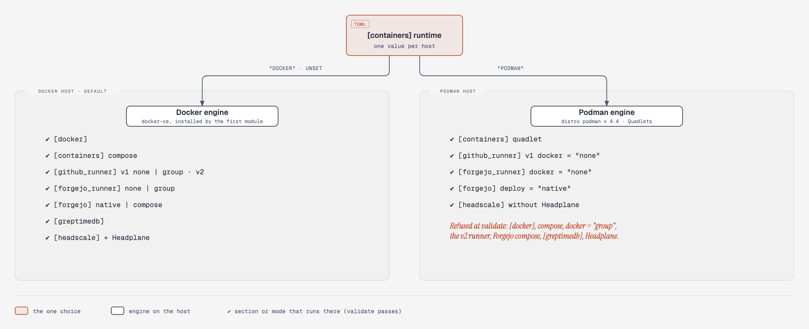

# Docker or Podman: one engine per host

No, you can't run both. A host runs Docker or Podman, set by `[podman]` or
`[containers] runtime`. Every module that needs Docker installs docker-ce, so
mixing them would put docker-ce next to Podman, and `anvil validate` refuses
that config.

- **Docker host:** any config without `[podman]` or `runtime = "podman"`. `[docker]` installs
  docker-ce (or, `source = "distro"`, docker.io); without it, the first module that needs Docker does
  (`[docker] source` picks where it comes from).
- **Podman host:** `[podman]` or `[containers] runtime = "podman"`. Podman ≥ 4.4 from the
  distro; the probe stops older hosts (Debian 12, Ubuntu 22.04) with `FAILED:`.



[Full size](../diagrams/container-engines.html).

| Module and mode | Docker host | Podman host |
|---|---|---|
| `[docker]` (daemon.json: capped logs, source) | ✔ | Refused |
| `[podman]` (containers.conf: capped logs, source) | Refused | ✔ |
| `[containers]` compose projects | ✔ | Refused |
| `[containers]` Quadlets | Refused (`needs a Podman host`) | ✔ |
| `[github_runner]` v1 `docker = "none"` | ✔ | ✔ |
| `[github_runner]` v1 `docker = "group"` | ✔ installs Docker | Refused |
| `[github_runner]` v1 `docker = "podman"` | Refused (`needs a Podman host`) | ✔ rootless Podman in each runner's unit |
| `[github_runner]` v1 `docker = "rootless"` | ✔ rootless dockerd in each runner's unit | ✔ as `"podman"` |
| `[github_runner]` v2 `mode = "ephemeral"` | ✔ installs Docker + sysbox | ✔ Podman sandbox per job |
| `[forgejo_runner]` `docker = "none"` | ✔ | ✔ |
| `[forgejo_runner]` `docker = "group"` | ✔ installs Docker | Refused |
| `[forgejo_runner]` `docker = "podman"` | Refused (`needs a Podman host`) | ✔ rootless Podman in the runner's unit |
| `[forgejo_runner]` `docker = "rootless"` | ✔ rootless dockerd in the runner's unit | ✔ as `"podman"` |
| `[coding_agents]` `docker = "rootless"` | ✔ rootless dockerd as the agent | ✔ rootless Podman as the agent |
| `[forgejo]` `deploy = "native"` | ✔ | ✔ |
| `[forgejo]` `deploy = "compose"` | ✔ with `[docker]` or a v2 runner | Refused (use `"quadlet"`) |
| `[forgejo]` `deploy = "quadlet"` | Refused | ✔ Quadlet `forgejo.container` |
| `[greptimedb]` | ✔ installs Docker | ✔ Quadlet `anvil-greptimedb.container` |
| `[headscale]` | ✔ | ✔ |
| `[headscale]` `headplane = true` | ✔ installs Docker | ✔ Quadlet `headplane.container` |
| `[headscale]` `headplane_docker_socket = true` | ✔ | Refused |

## `[docker]` defaults

Each key is on unless set to `false`:

| Key | daemon.json | What changes |
|---|---|---|
| `userns_remap` | `"userns-remap": "default"` | Containers run as unprivileged host uids; Docker uses a separate store (`/var/lib/docker/100000.100000`) |
| `iptables_off` | `"iptables": false` | Docker stops writing iptables rules: published ports fall behind ufw, containers lose outbound NAT |
| `live_restore` | `"live-restore": true` | Containers keep running while dockerd restarts |

**Adding `[docker]` to a host in use.** Turning on userns-remap hides every
existing image and container (they stay in the old store). So while
`userns_remap` is only defaulted, `check`/`apply` stop with `FAILED:` when
Docker already has images or containers and `daemon.json` has no
`userns-remap`. Set `userns_remap = true` to accept the switch, or `false`
to keep the current store. A defaulted `iptables_off` over containers that
publish ports prints a warning; set it explicitly to silence it. dockerd
must be running for the check to see images.

## Housekeeping on both engines

| What | Docker host | Podman host |
|---|---|---|
| Container logs | 10m × 3 per container: `[docker]`, a v2 runner, or (neither) a logs-only `daemon.json` anvil creates; an existing one is kept. `[docker] log_driver = "journald"`: the journal instead, capped by journald's `SystemMaxUse` ([monitoring](monitoring.md)) | `log_size_max` 10m in the containers.conf drop-in (k8s-file); `[podman] log_driver = "journald"`: the journal |
| Superseded images | After a pull and restart, older images of the same repository go once no container uses them: Forgejo, compose projects, `[greptimedb]`, Headplane, the v2 sandbox base | Same, for Quadlets |

New log limits reach containers created after the change. On a Docker host
without `daemon.json`, the first apply creates it and restarts dockerd once:
running containers restart. `rollback` keeps images.

## Docker host: v2 runner + Forgejo compose

```toml
[github_runner]
mode = "ephemeral"               # installs Docker + sysbox
app_id = 123456
installation_id = 7654321
app_key = "${GITHUB_APP_KEY}"
runner_group_id = 3

[github_runner.runners.ci]
url = "https://github.com/acme"
labels = ["anvil"]

[forgejo]
domain = "git.example.org"
deploy = "compose"               # runs on the Docker the runner installed
secret_key = "${FORGEJO_SECRET_KEY}"
internal_token = "${FORGEJO_INTERNAL_TOKEN}"
jwt_secret = "${FORGEJO_JWT_SECRET}"
```

→ `config OK`. Each job runs in its own sysbox sandbox; Forgejo runs as
the rootless image. Add `[caddy]` to serve it ([Forgejo](forgejo.md)).

## Podman host: Quadlets + v1 runner + Forgejo

```toml
[containers]
runtime = "podman"

[containers.quadlet.web]
content = """
[Container]
Image=docker.io/library/nginx:alpine
PublishPort=127.0.0.1:8080:80
[Install]
WantedBy=multi-user.target
"""

[github_runner]                  # v1
docker = "none"

[github_runner.runners.build-1]
url = "https://github.com/acme/app"
token = "${GITHUB_RUNNER_TOKEN:-}"
labels = ["anvil"]

[forgejo]
domain = "git.example.org"
deploy = "quadlet"               # the rootless image as a Quadlet ("native" works too)
actions = true
secret_key = "${FORGEJO_SECRET_KEY}"
internal_token = "${FORGEJO_INTERNAL_TOKEN}"
jwt_secret = "${FORGEJO_JWT_SECRET}"
```

→ `config OK`. No docker-ce is installed. Jobs run on the host as
`github-runner`, without containers. `[greptimedb]` and `headplane = true`
need no extra field here: they run as Quadlets.

## Refused combinations

On the Podman host above:

| Change | `anvil validate` prints (exit 1) |
|---|---|
| add `[docker]` | `invalid config: [docker] hardens dockerd; it cannot run on a Podman host ([podman] or [containers] runtime = "podman"). Drop [docker] or use a Docker host` |
| `docker = "group"` in `[github_runner]` | `invalid config: github_runner docker = "group" installs Docker; it cannot run on a Podman host ([podman] or [containers] runtime = "podman"). Use docker = "none", docker = "podman" (rootless), a Docker host, or the v2 runner (mode = "ephemeral", a Podman sandbox per job)` |
| `sandbox_runtime = "sysbox-runc"` in a v2 `[github_runner]` | `invalid config: github_runner.sandbox_runtime = "sysbox-runc" installs Docker + sysbox; it cannot run on a Podman host. Drop it (default "podman")` |
| `deploy = "compose"` in `[forgejo]` | `invalid config: forgejo.deploy = "compose" runs on Docker; this is a Podman host ([podman] or [containers] runtime = "podman"). Use deploy = "quadlet"` |
| `listen_address = "0.0.0.0"` in `[greptimedb]` (same for `headplane_listen`) | `invalid config: greptimedb.listen_address: "PublishPort=0.0.0.0:4000:4000" may publish beyond 127.0.0.1; rootful Podman (netavark) would expose it past ufw — use a loopback address and a reverse proxy or the tailnet` |
| `headplane_docker_socket = true` in `[headscale]` | `invalid config: headscale.headplane_docker_socket mounts the Docker socket; it cannot run on a Podman host ([podman] or [containers] runtime = "podman"). Drop headplane_docker_socket (Headplane itself runs as a Quadlet)` |

On a Docker host, Forgejo compose without `[docker]` or a v2 runner:
`invalid config: forgejo.deploy = "compose" needs Docker: add [docker] (or a [github_runner] with mode = "ephemeral")`.
On a Docker host, `sandbox_runtime = "podman"`:
`invalid config: github_runner.sandbox_runtime = "podman" needs a Podman host ([podman] or [containers] runtime = "podman"); on a Docker host drop it (default "sysbox-runc")`.
