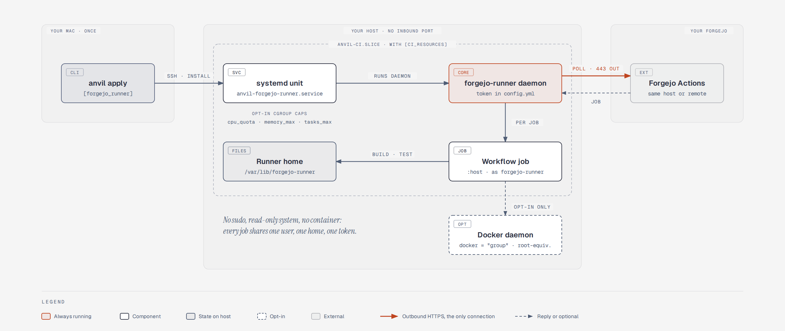
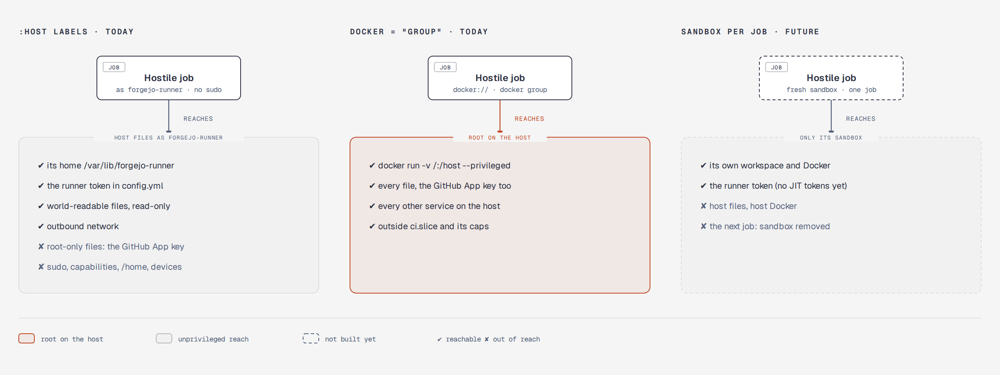

# Forgejo Actions runner (`[forgejo_runner]`)

`[forgejo_runner]` installs one Forgejo Actions runner: the pinned,
SHA-256-verified `forgejo-runner` binary as the unprivileged `forgejo-runner`
user in a hardened systemd unit. It opens nothing inbound.

**Where jobs run:** with `mode = "ephemeral"` each job gets a fresh sandbox
([below](#a-sandbox-per-job-mode--ephemeral)). Otherwise, with `:host` labels jobs run
unprivileged. With `docker://` labels jobs run in containers: on a Docker host
(`group`) every job is root on the host; on a Podman host (`podman`) they run
in rootless Podman as `forgejo-runner`. Choose `:host` when the host also
holds other secrets (for example the GitHub App key): with `group`, every job
could read them.

| Mode | Where a job runs | Between jobs | A hostile job reaches |
|---|---|---|---|
| `<name>:host`, `docker = "none"` | On the host, as `forgejo-runner` | Nothing isolated: same user, home, token | Its home, the runner token, world-readable files; not root-only files, no `sudo` |
| `<name>:docker://<image>`, `docker = "group"` (Docker host) | In a Docker container | Fresh container | **Root on the host**: `docker run -v /:/host --privileged` |
| `<name>:docker://<image>`, `docker = "podman"` (Podman host) | In a rootless Podman container, inside the runner's unit | Fresh container | Only the `forgejo-runner` user's files, never host root: container root is that uid |
| `<name>:docker://<image>`, `docker = "rootless"` | In a container of the host's engine, rootless inside the runner's unit (on a Podman host: as `"podman"`) | Fresh container | Same as `"podman"`: only the `forgejo-runner` user's files |
| `mode = "ephemeral"` (Docker host) | In a fresh sandbox with its own dockerd: in the slot user's rootless Docker (default) or sysbox | Sandbox and its volume removed | Only its sandbox, and that job's one-job runner token |

Use it for repos where you trust everyone who can push. Field reference:
[`[forgejo_runner]`](../05_configuration.md#forgejo_runner). Example:
[examples/forgejo-runner.toml](../../examples/forgejo-runner.toml).

## Diagrams



[Full size](../diagrams/forgejo-runner-flow.html). The daemon polls Forgejo
over outbound HTTPS; each job runs as `forgejo-runner` inside
`anvil-forgejo-runner.service` (in `ci.slice` with `[ci_resources]`).



[Full size](../diagrams/forgejo-runner-security.html). `:host` vs
`docker = "group"` vs a sandbox per job. `docker = "podman"` reaches at most
the left panel: rootless Podman reaches only the runner user's files.

## Quick start (`:host`, Forgejo on the same host)

1. Set `actions = true` in `[forgejo]`.
2. Generate a 40-hex secret and keep it in your secret store:

   ```bash
   export FORGEJO_RUNNER_TOKEN=$(openssl rand -hex 20)
   ```

3. Register it. The command reads the secret on stdin and prints the runner
   UUID:

   ```bash
   printf %s "$FORGEJO_RUNNER_TOKEN" | ssh <host> sudo docker exec -i forgejo \
     /app/gitea/gitea --work-path /var/lib/forgejo --config /etc/forgejo/app.ini \
     forgejo-cli actions register --secret-stdin --name <host> --labels <host>:host
   ```

   Native Forgejo: `sudo -u git /usr/local/bin/forgejo --work-path … --config …`,
   same arguments. Remote Forgejo: *Settings → Actions → Runners → Create new
   runner* (site, org, user or repo; that decides which repos can use it),
   copy UUID and token.

4. Configure and apply:

   ```toml
   [forgejo_runner]
   # url = "https://git.example.org/"  # default: https://<forgejo.domain>/
   uuid = "<printed UUID>"
   token = "${FORGEJO_RUNNER_TOKEN}"
   labels = ["<host>:host"]
   docker = "none"
   cpu_quota = "200%"
   memory_max = "4G"
   ```

5. In a workflow, `runs-on: <host>` → the job runs on the host as
   `forgejo-runner`.

The token sits in `/etc/forgejo-runner/config.yml` (root-owned, readable by
the runner; never in `diff`), so every apply needs it; an empty token fails
apply. Jobs never get the Docker socket (`container.docker_host = "-"`).

## What a job can and can't do

As for the [GitHub v1 runner](github-runner.md#what-a-job-can-and-cant-do):
no `sudo` or capabilities, read-only system paths, no `/home` or devices,
private `/tmp`, writes only `/var/lib/forgejo-runner`. Two differences:

- **No wipe between jobs.** Files a job leaves in the home stay for the next.
- **A job can read the runner token** in `config.yml` and impersonate the
  runner until you delete it in Forgejo. Root-only files (e.g.
  `/etc/anvil/github-runner/app.pem`, 0600) stay out of reach.

Limits are the same as GitHub's: `cpu_quota`/`memory_max`/`tasks_max` per
runner, [`[ci_resources]`](../05_configuration.md#ci_resources) for all CI.
Containers under `docker = "group"` run under dockerd, outside both;
under `docker = "podman"` they run inside the runner's unit, so both apply.

## Container jobs on a Podman host (`docker = "podman"`)

```toml
[podman]

[forgejo_runner]
uuid = "<printed UUID>"
token = "${FORGEJO_RUNNER_TOKEN}"
labels = ["debian:docker://docker.io/library/debian:trixie-slim"]
docker = "podman"
memory_max = "4G"
```

→ `runs-on: debian` runs the job in a `debian:trixie-slim` container as
`forgejo-runner`'s subordinate uids. anvil installs `podman`, `uidmap`,
`passt`, `podman-docker` and `dbus-user-session`, gives `forgejo-runner` a 65536-id
`/etc/subuid`/`/etc/subgid` range, and starts `podman system service` inside
`anvil-forgejo-runner.service` on `/run/user/<uid>/forgejo-runner/podman.sock`
(`DOCKER_HOST`; job containers never get it). Containers are children of
that service: they stay in the unit's cgroup and caps (`Delegate=yes` hands
that cgroup to the runner user, else podman moves itself into a user scope). Images live in
`/var/lib/forgejo-runner/.local/share/containers`.

To run rootless Podman the unit drops `NoNewPrivileges`, the empty
`CapabilityBoundingSet=`, `PrivateDevices`, `RestrictSUIDSGID`,
`ProtectKernelTunables` and `ProtectControlGroups` (setuid `newuidmap`,
`/dev/net/tun`, fresh `/proc` and `/sys` mounts). The runner user still has no
`sudo`, and system paths stay read-only. Stopping the unit ends running jobs. The user's manager lingers (`loginctl enable-linger`, undone by rollback only
if anvil enabled it): the unit binds only `/run/user/<uid>` past its
`/home`/`/root` tmpfs, sets `XDG_RUNTIME_DIR=/run/user/<uid>` (Ubuntu's pasta profile allows netns
files only there; aardvark-dns, the DNS of job networks, starts in a user scope
over that dir's bus) and keeps the socket and podman's runroot in
`/run/user/<uid>/forgejo-runner`.
On a Docker host `docker = "podman"` is refused: `forgejo_runner docker =
"podman" needs a Podman host`. Use `docker = "rootless"` there: a rootless
dockerd (`docker-ce-rootless-extras`, so `[docker] source = "vendor"`) runs
inside the unit with its own `XDG_RUNTIME_DIR`, cgroupfs (containers stay in
the unit, under the caps) and the same dropped hardening. The runner hands no
socket to jobs (`docker_host: "-"`) on either engine.

## Operate

- **Logs:** `journalctl -u anvil-forgejo-runner`; step logs live in Forgejo.
- **Caches:** the daily `anvil-forgejo-runner-prune.timer` wipes
  `~/.cache`, `~/.cargo`, `~/.rustup` and `~/.npm` under
  `/var/lib/forgejo-runner` once past `home_cache_max` (20G), only while no
  job runs. Podman's images are not touched.
- **Updates:** forgejo-runner does not update itself. Bump anvil (pin
  13.2.1) or set `version` + `sha256`.
- **Rollback** (`anvil rollback --only forgejo_runner`) stops the service and
  removes the unit, the config, the binary (if anvil installed it) and the
  `forgejo-runner` user (if anvil created it) and the subordinate id range
  anvil added. The runner stays listed in Forgejo as offline until you delete
  it there. `/var/lib/forgejo-runner` (with Podman's images) and packages stay.

Live-tested on a Debian 13 VPS, 2026-11-03: `:host`, `docker = "none"`, 200% CPU / 4G.

| Check | Result |
|---|---|
| Register with `forgejo-cli actions register --secret-stdin` | ✔ UUID printed |
| Workflow on push | ✔ green |
| Re-apply | ✔ |
| Rollback | ✔ binary, config, unit gone |
| Re-apply, then a second workflow | ✔ green |
| `anvil check` | ✔ aligned |

## A sandbox per job (`mode = "ephemeral"`)

```toml
[forgejo_runner]
mode = "ephemeral"
api_token = "${FORGEJO_API_TOKEN:-}"   # see the scopes below
owner = "acme"                         # or "acme/app"; omitted = instance-wide
labels = ["debian:host", "node:docker://node:22-trixie"]
capacity = 2                           # sandboxes waiting or running at once
```

This works like the [GitHub v2 runner](github-runner.md) and needs a Docker
host and Forgejo ≥ 15. Each slot `anvil-forgejo-runner-<n>.service` loops through
these steps:

1. Recreate the slot's volume (`sandbox_disk`, 40 GB).
2. Register an ephemeral runner via the Forgejo API.
3. Start a fresh sandbox (`--init` reaps zombies; `sandbox_cpus`/`_memory`/`_pids`,
   default 2 CPUs, 4 GB, 2048 pids) in the
   slot user's rootless dockerd ([below](#sandbox_runtime--docker-rootless)), or with
   `sandbox_runtime = "sysbox-runc"` in root's dockerd + sysbox, in `ci.slice` with `[ci_resources]`. It runs its own dockerd and
   `forgejo-runner one-job` with the host's verified binary, mounted read-only.
4. Remove the sandbox and delete the runner.

Forgejo gives an ephemeral runner one job, then deletes it. `:host` labels
run in the sandbox, and `docker://` labels run on the sandbox's own Docker.

**Network.** Sandboxes use the Docker network `anvil-forgejo-sandbox`
(bridge `anvil-fjsb0`). When the `url`'s host resolves to an address of this
host (Forgejo behind Caddy here, e.g. `listen = "tailnet"`), apply adds
`ufw allow in on anvil-fjsb0 to any port <url port> proto tcp`. Without it,
ufw drops sandbox traffic to the tailnet-only port. Every job can then reach
whatever this host serves on that port, as any tailnet member can. The rule
is removed on rollback.

**Switching modes.** Ephemeral mode stops a persistent runner on the host
and moves its unit, prune timer and `config.yml` to `.anvil.bak`; rollback
restores and restarts it. Persistent mode does the same for leftover slots
(units, minter, API token). A failed job does not slow a slot down: only a
failed registration or sandbox start backs off.

**The API token is the powerful credential.** It sits only on the host, in
`/etc/anvil/forgejo-runner/api-token` (root, 0600), never in `diff` or argv.
Give it the narrowest owner that works:

| `owner` | Token scope | Account must be |
|---|---|---|
| `"org"` | `write:organization` | org owner |
| `"owner/repo"` | `write:repository` | repo admin |
| omitted (instance-wide) | `write:admin` | site admin |

A job can read only its own runner token, which can take no second job and
is deleted with the job. `uuid`, `token`, `docker`, the cgroup caps and
`home_cache_max` are persistent-only. A Podman sandbox is not available
yet.

### `sandbox_runtime = "docker-rootless"`

The default: no sysbox and no root daemon behind the jobs. Each slot `n` gets a
system user `anvil-fjr-<n>` with a lingering user manager and its own rootless
dockerd; the sandbox runs `--privileged` in it, so Docker inside jobs
(`docker build`, `docker://` labels) works, while root in the sandbox is that
user on the host, never root.

| | `sysbox-runc` | `docker-rootless` |
|---|---|---|
| Sandbox engine | root dockerd + sysbox | the slot user's rootless dockerd |
| A sandbox escape lands as | an unprivileged uid | the slot user (no other slot, no root) |
| Network | bridge `anvil-fjsb0`, ufw rule for a local Forgejo | from the host as the slot user; host loopback unreachable |
| Per-job CPU/memory in Vector | `ci.slice` | the slot user's `docker-<id>.scope` (GECOS `umask=022` keeps it readable; Vector includes it by uid); the `anvil-ci` dashboard shows both |

Per job the slot volume (`/var/lib/anvil-fjr-<n>/vol`, holding the engine's
data-root too) is re-made and the sandbox image, saved by root's Docker to
`/var/lib/anvil-ci/forgejo-runner-sandbox.tar`, loaded into the fresh engine:
nothing a job leaves reaches the next one. Needs `[docker] source = "vendor"`
(`docker-ce-rootless-extras`). Switching a slot from sysbox removes its old
sandbox (the `anvil-forgejo-sandbox` network and its ufw rule stay until a
rollback). Each sandbox keeps its own `sandbox_*` limits; `[ci_resources]`
can't cap their sum (they run under the slot users, not `ci.slice`), so
its `cpu_weight` goes on the slot users' slices: CI yields to everything else
under contention and uses idle cores otherwise.

## Troubleshooting

| Symptom | Cause and fix |
|---|---|
| A push starts no workflow | The repo was created before `actions = true`, so its Actions unit is off: *repo Settings → Units → Actions* on |
| Jobs stay waiting | `runs-on` must match a label's name: `labels = ["my-host:host"]` → `runs-on: my-host` |
| `FAILED: forgejo_runner: token is empty` | Export `FORGEJO_RUNNER_TOKEN`; every apply needs it |
| `FAILED: forgejo_runner: api_token is empty` | Ephemeral: export `FORGEJO_API_TOKEN`; every apply needs it |
| Ephemeral job never starts, slot logs `Declare … context deadline exceeded` | The sandbox can't reach Forgejo: check `ufw status` for the `anvil-fjsb0` rule. A Forgejo on this host whose name doesn't resolve to a local address needs that rule by hand |
| Rollback reports `FAILED: … runner ids … still registered` | Forgejo was unreachable during rollback: delete those runners in the UI, then the listed `.ids` file |
| Ephemeral slot logs `register or sandbox failed` | `journalctl -u anvil-forgejo-runner-1`: a 401/403 means the token's scope or account doesn't match `owner`; a 404/405 means Forgejo < 15 |
| The daemon logs its name as `runner` | Cosmetic: the generated config sets no `name` |
