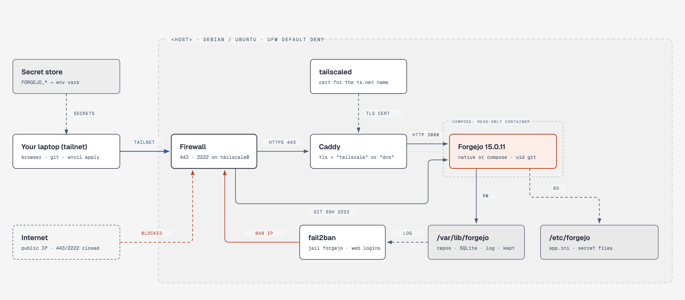

# Forgejo (`[forgejo]`)

`[forgejo]` runs a [Forgejo](https://forgejo.org) git forge: the pinned
15.0.11 LTS, release signature verified, HTTP on `127.0.0.1:3000` behind
`[caddy]` (or `[tls]`), git over SSH on Forgejo's own server (port 2222).
Secrets come from `${ENV}`; rollback never deletes `/var/lib/forgejo`.

| `deploy` | Needs | Runs as | Trade-off |
|---|---|---|---|
| `"native"` (default) | nothing | upstream binary, sandboxed `forgejo.service` | No Docker on the host |
| `"compose"` | `[docker]` (or a v2 `[github_runner]`) | digest-pinned rootless image, host network | Same image everywhere; the Docker socket is root |
| `"quadlet"` | a Podman host (`[podman]`) | the same image as the Quadlet `/etc/containers/systemd/forgejo.container`, host network | No daemon; Podman ≥ 4.4 |

All use the same `app.ini`, secrets, data and unit name (`forgejo.service`),
so you can switch (see Operate).

```toml
[podman]

[forgejo]
domain = "git.example.org"
deploy = "quadlet"
secret_key = "${FORGEJO_SECRET_KEY}"
internal_token = "${FORGEJO_INTERNAL_TOKEN}"
jwt_secret = "${FORGEJO_JWT_SECRET}"
```

→ `apply` installs Podman, pulls the pinned image and starts
`forgejo.service`; `sudo podman ps` lists `forgejo`, `curl
127.0.0.1:3000/api/healthz` answers. Rollback stops it and keeps
`/var/lib/forgejo` and the image.
Field reference: [`[forgejo]`](../05_configuration.md#forgejo),
[`[caddy]`](../05_configuration.md#caddy),
[`[fail2ban]`](../05_configuration.md#fail2ban). Decisions:
[design doc](../design/forgejo.md). Public-facing variant with
`[tls]` (nginx): [examples/forgejo.toml](../../examples/forgejo.toml).

## Diagram



[Full size](../diagrams/forgejo-tailnet.html). The setup below: only tailnet
devices reach 443 and 2222; fail2ban bans failed web logins at the firewall.

## Quick start (tailnet only)

```toml
[firewall]                         # required by listen = "tailnet"

[tailscale]
auth_key = "${TS_AUTHKEY:-}"       # only needed to join

[caddy]
listen = "tailnet"                 # 443 on tailscale0 only

[[caddy.site]]
domain = "<host>.<tailnet>.ts.net" # MagicDNS name; enable HTTPS Certificates in the tailnet
upstream = "127.0.0.1:3000"
tls = "tailscale"

[forgejo]
domain = "<host>.<tailnet>.ts.net" # ROOT_URL and the SSH clone host
# deploy = "compose"               # needs [docker]; "quadlet" on a Podman host
listen = "tailnet"                 # 2222 on tailscale0 only
secret_key = "${FORGEJO_SECRET_KEY}"
internal_token = "${FORGEJO_INTERNAL_TOKEN}"
jwt_secret = "${FORGEJO_JWT_SECRET}"
admin_username = "forgeadmin"
admin_email = "admin@example.com"
admin_password = "${FORGEJO_ADMIN_PASSWORD}"

[fail2ban]                         # adds the forgejo jail
```

Generate the secrets once (`forgejo generate secret <NAME>` on any machine),
keep them in your secret store, export them, `anvil apply`:

| Variable | What it is |
|---|---|
| `FORGEJO_SECRET_KEY` | Encrypts stored secrets (2FA). **Never lose it:** without it 2FA secrets are unreadable |
| `FORGEJO_INTERNAL_TOKEN` | Authenticates Forgejo's CLI and hooks to its internal API |
| `FORGEJO_JWT_SECRET` | Signs OAuth2 tokens; base64url of 32 bytes (`generate secret JWT_SECRET`) |
| `FORGEJO_ADMIN_PASSWORD` | Bootstrap password for the admin (≥ 8 chars); used once, never reset |

First login: open `https://<host>.<tailnet>.ts.net` from a tailnet device and
sign in as the admin; Forgejo forces a new password. Then *Settings → SSH /
GPG keys* → add your public key, and:

```bash
ssh -T -p 2222 git@<host>.<tailnet>.ts.net     # authenticates; see troubleshooting
git clone ssh://git@<host>.<tailnet>.ts.net:2222/<owner>/<repo>.git
```

Port 2222 is Forgejo's built-in SSH server (keys only), not the host's sshd:
`[sshd]`, `AllowUsers` and the sshd jail are not involved.

## Own domain

Serve `git.example.com` while staying tailnet-only:

1. DNS records pointing at the host's **tailnet** addresses (from
   `tailscale ip`): `A 100.x.y.z`, `AAAA fd7a:115c:a1e0::…`. Public, but
   only tailnet devices can reach them.
2. An Infomaniak API token with scopes **`dns:read`, `dns:write`,
   `domain:read`**, exported as `INFOMANIAK_API_TOKEN`.
3. A second site and the new `domain`:

```toml
[[caddy.site]]
domain = "git.example.com"
upstream = "127.0.0.1:3000"
tls = "dns"                        # ACME DNS-01: no public port needed
dns_provider = "infomaniak"
dns_token = "${INFOMANIAK_API_TOKEN}"

[forgejo]
domain = "git.example.com"         # ROOT_URL and clone URLs follow
```

The first apply builds `/usr/local/bin/caddy-anvil` on the host (Caddy
2.11.7 + `caddy-dns/infomaniak` v1.0.2, Go 1.27.3; ~1.5 GB RAM, a few
minutes, once) and installs it only if its SHA-256 matches the pin. Keep the
`tls = "tailscale"` site as a fallback name.

## Runner

To run Forgejo Actions jobs on this host, see the
[Forgejo runner guide](forgejo-runner.md) (`[forgejo_runner]`, needs `actions = true`).
`mode = "ephemeral"` runs each job in a fresh sysbox sandbox with a runner
registered for that one job (Docker host).

## Security

| Layer | What |
|---|---|
| Ports | `listen = "tailnet"` on both: 443 and 2222 only on `tailscale0`; nothing public. Forgejo HTTP is loopback only |
| fail2ban | Jail `forgejo` reads `/var/lib/forgejo/log/forgejo.log` for failed web logins (real client IP via the proxy) and bans that IP on 443 (Caddy's `https_port`) and 2222. Tailnet IPs are banned too; only loopback is exempt. Defaults `maxretry` 5, `findtime`/`bantime` 10m; tune in `[fail2ban.jails.forgejo]`. Host SSH stays reachable |
| Native unit | `NoNewPrivileges`, `ProtectSystem=strict` (writes only `/var/lib/forgejo`), `PrivateTmp`, `RestrictSUIDSGID`, as `git` (nologin) |
| Compose | read-only root, `cap_drop: [ALL]`, `no-new-privileges`, uid `git`, 2 GB / 1024 pids, `/etc/forgejo` mounted read-only |
| Forgejo | Registration off, installer locked, git hooks off, offline mode, secure cookies |
| Secrets | Never in the TOML: `${ENV}` → `/etc/forgejo/*` (0640 `root:git`). `diff` never prints them, `--dry-run` masks them; the admin password never enters a command line (created with a random one, then set via the local API) |

Unban: `sudo fail2ban-client set forgejo unbanip <ip>`; list bans with
`sudo fail2ban-client status forgejo`.

## Operate

- **Logs:** `/var/lib/forgejo/log/forgejo.log`; `journalctl -u forgejo`
  (native, quadlet) or `docker logs forgejo` (compose); Caddy: `journalctl -u caddy`.
- **Upgrade:** set `version`; compose and quadlet also need `image_digest`
  (`sha256:…` of `<version>-rootless`). The signature is always checked;
  `sha256_amd64`/`sha256_arm64` are optional. Built in for 15.0.11 only.
  Forgejo restarts only when binary, image, `app.ini`, a secret or the unit
  changed. After the restart the old image is removed if no container
  uses it.
- **Switch modes:** change `deploy` and apply. The service restarts in the
  other mode on the same data; the native binary stays installed. To
  `"quadlet"`: `anvil rollback --only forgejo` first, else apply stops with
  `FAILED:` (`/etc/systemd/system/forgejo.service` would shadow the Quadlet).
- **Rollback** (`anvil rollback --only forgejo`): stops the service, removes
  config, unit, secret files and the binary (if anvil installed it).
  `/var/lib/forgejo` and the `git` user stay; re-apply brings it back on the
  same data and admin.
- **Backup** `/var/lib/forgejo` (repos, SQLite, attachments): `forgejo dump`
  as `git`, or stop the service first. Postgres: `pg_dump`.

Live-tested on an Ubuntu 26.04 VPS, 2026-11-03, compose behind Caddy:

| Check | Result |
|---|---|
| Public 80/443/2222/3000 | closed; 443 + 2222 open on `tailscale0` only |
| HTTPS with the Tailscale cert, then own domain via DNS-01 | ✔ (pinned Caddy build hash matched on Linux) |
| Push and clone over SSH on 2222 | ✔ |
| Failed web login | logged with the real tailnet IP; banned IP blocked on 443 + 2222, host SSH 22 still open; unban reopens |
| Rollback, then re-apply | data unchanged (DB hash), same admin |
| compose → native → compose on the same data | ✔, `check` aligned |

## Troubleshooting

| Symptom | Cause and fix |
|---|---|
| `tls = "dns"`: ACME fails with HTTP 403 `all_scopes` | Infomaniak token lacks `domain:read`. Create one with `dns:read`, `dns:write`, `domain:read` |
| `ssh -T -p 2222 git@…` prints "Unable to access repository path" | Normal before your first repo: the key authenticated. Create a repo and clone it |
| `forgejo did not answer … within 60s` | Read the logs named in the message (`journalctl -u forgejo` or `docker logs forgejo`) |
| Load warning: no proxy serves `domain` | Add a `[[caddy.site]]` with that `domain` and upstream `127.0.0.1:<http_port>` (or `[tls]`) |
| Compose rollback reports `FAILED:` though everything was removed | False positive. Fixed: update anvil |
