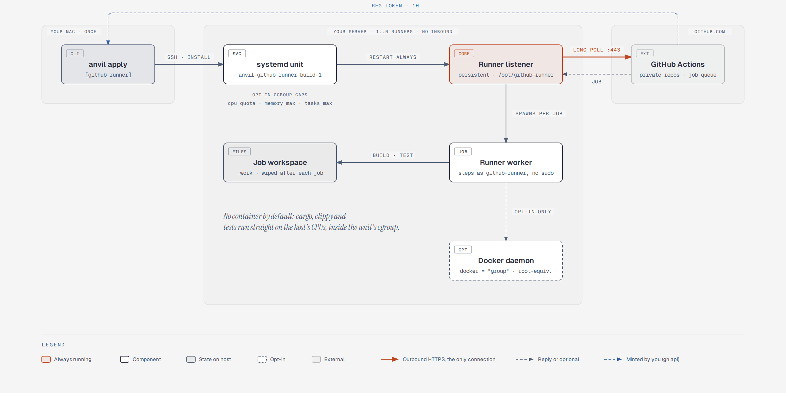
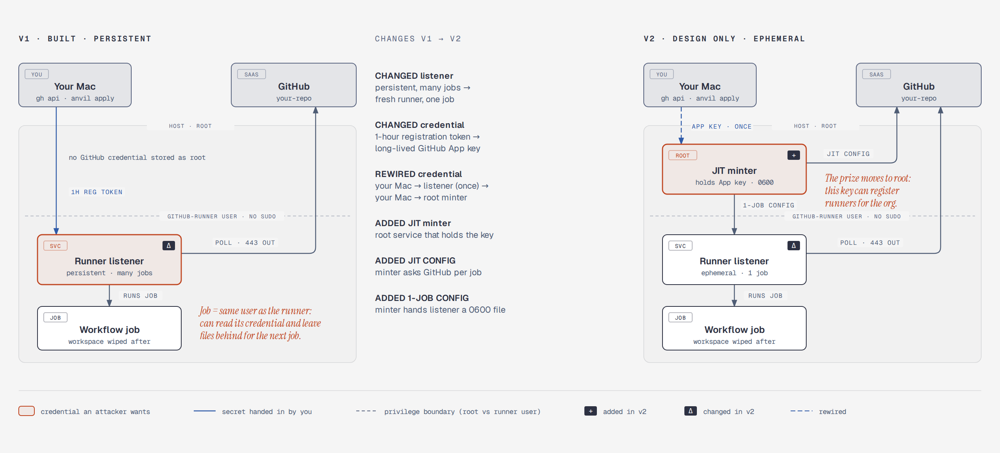
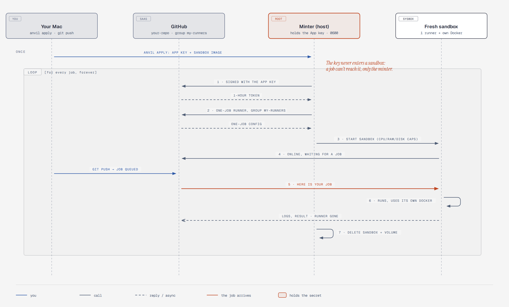

# GitHub Actions runner (`[github_runner]`)

`[github_runner]` installs self-hosted GitHub Actions runners on a host:
a pinned, SHA-256-verified `actions/runner` that runs as an unprivileged user
in a hardened systemd unit and opens nothing inbound. Use it for **private
repos** where only trusted people push.

| Mode | Use it for | Credential on the host | Docker in jobs |
|---|---|---|---|
| **v1** (default; no `mode` field) | Private repos, trusted pushers | None (one-hour token, used once) | `none`, `rootless` (the host's engine, rootless as the runner user), `group` (Docker host; jobs are root on the host) or `podman` (`rootless` on a Podman host) |
| **v2** `mode = "ephemeral"` | Docker jobs, private repos | GitHub App key, root-only | Own Docker in a sysbox sandbox per job |

**Docker host:** v1 and v2 both run (v1 `docker = "group"` and v2 install
Docker). **Podman host** (`[podman]` or `[containers] runtime = "podman"`):
v1 with `docker = "none"`, `"rootless"` or `"podman"`, or v2 with a Podman
sandbox; anything else is refused at validate. Every module:
[Docker or Podman](container-engines.md).

Field reference: [`[github_runner]`](../05_configuration.md#github_runner),
[`[ci_resources]`](../05_configuration.md#ci_resources). Decisions and
trade-offs: [design doc](../design/github-actions-runner.md).

## Diagrams



[Full size](../diagrams/github-runner-flow.html). v1 on the host: what
anvil installs, and how a job runs inside the unit.



[Full size](../diagrams/github-runner-security.html). Where the credential
lives in each mode, and what a hostile job can reach. v1 `docker = "rootless"`
(or `"podman"`) reaches what v1 does: a rootless engine reaches only the runner
user's files.



[Full size](../diagrams/github-runner-v2.html). Why v2 needs the GitHub App:
a minter on the host uses its key to get a fresh one-job runner per job.

## v1 quick start

```toml
[github_runner]
docker = "none"          # container:/services: jobs: "rootless" (either engine) or "group" (root on the host)
# disk_max = "150G"      # recommended: caps each runner's _work

[github_runner.runners.build-1]
url = "https://github.com/acme/app"      # repo runner; https://github.com/acme = org runner
token = "${GITHUB_RUNNER_TOKEN:-}"
remove_token = "${GITHUB_RUNNER_REMOVE_TOKEN:-}"
labels = ["anvil"]
# group = "private-ci"                   # org runners on a paid plan only
```

```bash
export GITHUB_RUNNER_TOKEN=$(gh api -X POST repos/acme/app/actions/runners/registration-token --jq .token)
anvil apply
```

For an org runner use `orgs/acme/actions/runners/registration-token`.
Workflows use `runs-on: [self-hosted, anvil]`.

The token lasts one hour and is only needed to register. Later applies need
none. Changing `url`, `labels`, `group` or `auto_update` re-registers, so
export a fresh token first; without one, apply prints `FAILED:`.

## What a job can and can't do

| Can | Can't |
|---|---|
| Write its workspace, the runner's home, its private `/tmp` and `/var/tmp` | `sudo` or gain capabilities (`NoNewPrivileges`, empty `CapabilityBoundingSet=`) |
| Reach GitHub over HTTPS (or `proxy`) | Write `/usr`, `/etc` or other system paths (read-only) |
| Use containers, with `docker = "rootless"`, `"podman"` or `"group"` only | See `/home` or block devices |
| Leave files in the runner dir (it must stay writable for self-update) | Find the previous job's workspace, `/tmp` or `/var/tmp` (wiped after each job) |

With `docker = "group"`, any workflow can run
`docker run -v /:/host --privileged …` and is root on the host. Enable it
only if everyone with push access could have root anyway, or give the runner
its own VM.

### Container jobs on rootless Docker (`docker = "rootless"`, Docker host)

`container:` and `services:` jobs run on a rootless dockerd started inside
each runner's unit, as `github-runner`: container root is that user's uid,
so `docker run -v /:/host` reaches only what `github-runner` can read. anvil
installs `docker-ce-rootless-extras` (Docker's repo; `[docker] source =
"distro"` is refused), `uidmap`, `slirp4netns` and `dbus-user-session`, gives
`github-runner` a 65536-id subordinate range, and lingers its manager. Each
unit's `XDG_RUNTIME_DIR` is its own `/run/user/<uid>/anvil-github-runner-<name>`
(rootlesskit state, socket, `DOCKER_HOST`); images live in each runner's
home (`~/.local/share/docker`). dockerd uses cgroupfs, so containers stay in
the unit's cgroup and `[ci_resources]` and the caps hold. The unit drops the
same hardening as the Podman variant below.

**Limit:** actions/runner mounts `/var/run/docker.sock` into job containers
regardless of `DOCKER_HOST` (an actions/runner bug). Here that is the root
socket, which `github-runner` cannot open: Docker *inside* a container job
fails. Use v2 for that.

On a Podman host `docker = "rootless"` is exactly `docker = "podman"`.

### Container jobs on a Podman host (`docker = "podman"`)

Add `[podman]` and set `docker = "podman"`: `container:` and `services:` jobs
run on rootless Podman as `github-runner`. Container root is that user's uid,
so `podman run -v /:/host` reaches only what `github-runner` can read.
anvil installs `podman`, `uidmap`, `passt`, `dbus-user-session` and
`podman-docker` (the `docker` the runner calls), gives `github-runner` a 65536-id `/etc/subuid`/`/etc/subgid`
range, resolves short image names on Docker Hub (as Docker does), and starts
`podman system service` inside each runner's unit on
`/run/user/<uid>/anvil-github-runner-<name>/podman.sock` (`DOCKER_HOST`,
`CONTAINER_HOST`). The `/var/run/docker.sock` the runner mounts into job
and service containers is that rootless socket (bound over `/run/podman` in
the unit only). Containers are children of that service: they stay in the
runner's cgroup (`Delegate=yes` hands it to `github-runner`), so
`[ci_resources]` and the runner's caps hold. Images live
in the runner's home, not on the `disk_max` volume.

To run rootless Podman the unit drops `NoNewPrivileges`, the empty
`CapabilityBoundingSet=`, `PrivateDevices`, `RestrictSUIDSGID`,
`ProtectKernelTunables` and `ProtectControlGroups`; the runner user still has
no `sudo` and system paths stay read-only. `github-runner`'s manager lingers (its
`/run/user/<uid>` is `XDG_RUNTIME_DIR`, for Ubuntu's pasta profile and
aardvark-dns' user bus; each runner keeps its socket and podman runroot in
its own subdir); the unit binds only that dir past its `/home`/`/root` tmpfs, and rollback stops
lingering only if anvil enabled it. Rollback removes the id range
anvil added; the home (with the images) stays. On a Docker host it is
refused: `github_runner docker = "podman" needs a Podman host`.

## Limits

| What | How | When exceeded |
|---|---|---|
| All CI together | [`[ci_resources]`](../05_configuration.md#ci_resources): slice `ci.slice` with `cpu_quota`/`memory_max`/`tasks_max`; `cpu_weight` 50 so sshd wins under load | CPU is throttled; memory OOM-kills the job |
| One runner and its jobs | `cpu_quota`/`memory_max`/`tasks_max` in `[github_runner]`, inside the slice | Same, per runner |
| Disk | `disk_max`: each runner's `_work` on its own sparse ext4 image, loop-mounted `nodev,nosuid` | The job fails with ENOSPC; the host disk is untouched. `check` drifts at 90% |
| Logs and caches | Daily `anvil-github-runner-prune.timer`: `_diag` logs older than `diag_retention_days` (14); with `disk_max`, `_tool`/`_actions` past half the cap; HOME caches (`~/.cache`, `~/.cargo`, `~/.rustup`, `~/.npm`) past `home_cache_max` (20G). Caches only while no job runs | — |

- **OOM:** only the job is killed; `OOMPolicy=continue` keeps the runner
  online for the next job.
- **`disk_max` is never resized.** A new size reports `FAILED:`: stop the
  runner, delete `/var/lib/anvil-ci/github-runner-<name>.img`, re-apply.
  The image is sparse, so the cap holds only while `/` has room for it.
- **Not capped:** job containers under `docker = "group"` run in dockerd's
  cgroup, outside the slice and the runner's caps (anvil warns), and
  `/var/lib/docker` is not on the capped volume.

## Operate

- **Logs and artifacts:** step logs, artifacts and `actions/cache` live on
  GitHub. On the host: `journalctl -u anvil-github-runner-<name>` and
  `/opt/github-runner/<name>/_diag`.
- **Several runners:** each has its own `HOME=/var/lib/github-runner/<name>`
  (`~/.cargo`, `~/.rustup`, caches) and can write only its home and dir.
  Apply restarts a runner only when its own unit, hook, mount or
  registration changed.
- **Updates:** by default the runner updates itself; anvil's pin is the
  floor. With `auto_update = false`, GitHub stops sending jobs 30 days after
  a newer runner release: re-apply with a newer anvil (or `version` +
  `sha256`) before then.
- **Network:** outbound HTTPS to `github.com`, `api.github.com`,
  `*.actions.githubusercontent.com`. With `[firewall] default_outgoing`
  other than `"allow"`, set `proxy` (validation enforces it).
- **Rollback** stops and removes the runner, its mount and timer. With
  `remove_token` (`…/actions/runners/remove-token`, one hour) it also
  deregisters on GitHub; without it, rollback warns and GitHub drops the
  offline runner after 14 days. The `github-runner` user goes once no runner
  is left, if anvil created it. Per-runner homes go only if anvil created
  them; the shared `/var/lib/github-runner` and packages stay.

## v2: ephemeral runners (`mode = "ephemeral"`)

Each job runs in a fresh sysbox sandbox with its own Docker; nothing
survives between jobs. Root inside the sandbox is an unprivileged user on
the host, and the host's Docker socket is not reachable. anvil runs once and
exits, so a root **minter** per slot asks GitHub for a new one-job runner
before every job. It needs a long-lived credential: a **GitHub App** private
key, root-only, outside every sandbox. amd64 and arm64; runners are org runners.

One-time owner setup:

1. **Runner group** (org settings → Actions → Runner groups): `my-runners`,
   access limited to the selected repo, public repos not allowed.
2. **GitHub App**: webhook off, no repository permissions, only
   *Organization → Self-hosted runners: Read and write*. Install it on the
   org; generate a private key and keep it off the repo.

```toml
[github_runner]
mode = "ephemeral"
app_id = 123456
installation_id = 7654321
app_key = "${GITHUB_APP_KEY}"    # the .pem content: export GITHUB_APP_KEY="$(cat app.pem)"
runner_group_id = 3
capacity = 2                     # sandboxes waiting or running at once, per runner
sandbox_cpus = "2"
sandbox_memory = "4g"
sandbox_disk = "40G"             # Docker data and _work, re-made for every job
# sandbox_pids = 2048
# sandbox_packages = ["build-essential", "pkg-config"]  # apt packages baked into the image
# sandbox_runtime = "docker-rootless" # default on a Docker host; "sysbox-runc"; "podman" on a Podman host

[github_runner.runners.ci]
url = "https://github.com/acme"  # org URL
labels = ["anvil"]
```

Full example: [examples/github-runner-ephemeral.toml](../../examples/github-runner-ephemeral.toml).
Workflows use `runs-on: [self-hosted, anvil]`; every runner also gets
`self-hosted`, `Linux` and `X64`.

What anvil puts on the host:

| Piece | What |
|---|---|
| Runtime | Docker (as `[docker]`) and sysbox-ce 0.7.1, SHA-256 pinned. Never removed |
| `daemon.json` | Owned by this module: sysbox runtime and subnets, capped logs, `[docker]` keys. A change restarts dockerd only with no sandbox running; otherwise apply warns |
| Key | `/etc/anvil/github-runner/app.pem`, root 0600; `diff` never prints it |
| Image | `anvil-github-runner:<content hash>`, built on the host from `/etc/anvil/github-runner/image/` (official `actions-runner` image pinned by digest; dockerd starts inside, then the runner takes one job) |
| Slots | `anvil-github-runner-<name>-<i>.service` (`i` = 1..`capacity`), in `ci.slice` with `[ci_resources]`; volume `/var/lib/anvil-ci/github-runner-<name>-<i>.img` |

Per job, the minter re-makes the slot volume, signs a JWT with the App key,
gets an installation token, mints a JIT runner config, starts the sandbox
(`--runtime=sysbox-runc`, `--init` so orphaned zombies are reaped instead of
filling the pids limit, `--cpus`/`--memory`/`--pids-limit`, the volume as
its `/var/lib/docker` and `_work`), and after the job removes it with its
volumes. Tokens never appear in a command line or log. API errors back off
from 10 s to 10 min.

- **Limits:** `sandbox_*` per sandbox; `[ci_resources]` caps all of them
  together. A full `sandbox_disk` fails the job, not the host. Writes to the
  sandbox's root filesystem outside those two paths are not capped.
- **Logs:** `journalctl -u anvil-github-runner-<name>-<i>`: the runner's
  terminal lines (jobs, results, errors). The full trace stays in the
  sandbox's `_diag` and goes with it.
- **Check** drifts when a slot unit is down, the runtime or the current
  image is missing, the key file changed, or an older image no sandbox uses
  is left.
- **Images:** a build prunes the Docker build cache (daemon-wide; a rebuild
  never reuses it). Apply removes older `anvil-github-runner` tags once no
  sandbox uses them, so a tag a slot still held goes on a later apply. Other
  images are never touched.
- **Rollback** stops the slots and removes sandboxes, the image, the build
  cache, the key and the volumes anvil created. Ephemeral runners vanish from GitHub by
  themselves.
- **Switching modes:** roll back with the old config first
  (`anvil rollback --only github_runner`), then change `mode`.

### docker-rootless

`sandbox_runtime = "docker-rootless"` drops sysbox: each slot gets a
system user `anvil-ghr-<runner>-<n>` (at most 32 characters) with its own
rootless dockerd, and the sandbox runs `--privileged` there, so root in it is
that user on the host, never root. `container:`/`services:` run natively on
the sandbox's own dockerd. Same slot volume, re-made per job and holding the
engine's data-root too; the image is built by root's Docker and loaded into
each fresh engine. Network, Vector and `[ci_resources]` behave as for the
[Forgejo runner](forgejo-runner.md#sandbox_runtime--docker-rootless).

### On Podman

On a Podman host (`[containers] runtime = "podman"` or `[podman]`) the same
config gets a Podman sandbox per job: `sandbox_runtime` defaults to
`"podman"`, and `"podman"` on a Docker host is refused. No Docker anywhere.

| Piece | What |
|---|---|
| Runtime | Podman, iptables and aardvark-dns (distro packages); `containers:2147483647:2147483648` in `/etc/subuid`/`/etc/subgid`; outbound next to ufw via the host's netavark iptables drop-in (`[podman]` or `[containers]`) |
| Sandbox | rootful `podman create --userns=auto:size=65536`: root inside is host uid 2147483647+. Same caps, slice and slot volume (`:U`) as above. The slot unit has no `NoNewPrivileges` (it would reach the job and break rootless Podman's `newuidmap`) |
| Inside | rootless Podman as `runner`, `docker` = podman-docker; the job's `services:`/`container:` run via the [podman hooks](https://www.npmjs.com/package/@universityofwarwick/github-runner-podman-hooks) 0.9.0 (SHA-256 pinned) |
| AppArmor | where it is on (Ubuntu), the sandbox runs under `/etc/apparmor.d/anvil-github-runner-sandbox` (Podman's default profile denies the inner mounts); parsed before load, a rejected profile reverts the apply |
| Image | `localhost/anvil-github-runner:<content hash>` from a `Containerfile` in the same directory |

`job.container.network` and `job.services.<id>.network` are empty here.
Publish the service port and use `127.0.0.1`; a `container:` job reaches a
service only by an alias it sets (the runner sends the hooks no service name):

```yaml
services:
  db:
    image: postgres:17          # fully qualified or a docker.io name
    ports: ["5432:5432"]        # steps: 127.0.0.1:5432
    options: --network-alias db # container: jobs: db:5432
```

Outcome: `check` lists `installs: Podman`; `services:` postgres answers on
`127.0.0.1:5432`, `docker run` works, and the next job finds no files or
images left.

## Security

- **Private repos only.** Whoever can trigger a workflow runs code on the
  host. Before a repo with this runner goes public, remove repo-level
  runners, move its CI to GitHub-hosted runners and keep every runner group
  closed to public repos
  ([Going public](#going-public)).
- **`docker = "group"` is root** on the host (above).
- **v1 keeps no long-lived secret** on the host, but a job can read the
  runner's own `.credentials` and impersonate that runner until it is
  removed. v2 trades this for an App key that never expires.

Live-tested on a Debian 13 VPS, 2026-11-02:

| Check | Result |
|---|---|
| Register with a token; re-apply without one is a no-op | ✔ |
| checkout, setup-node, `actions/cache` under the hardened unit | ✔ |
| `NoNewPrivs=1`, `CapBnd=0`, `/usr` and `/etc` read-only, no block devices, `/home` empty, `sudo` fails | ✔ |
| Next job sees no workspace, `/tmp` or `/var/tmp` leftovers | ✔ |
| 24 busy loops under an 800% slice | slice saturated; SSH stayed reachable |
| Filling a 150G `disk_max` volume | ENOSPC in the job; host disk untouched; next job clean |
| 25 GB job under a 20G cap | Job OOM-killed; host unaffected |
| Rollback with a remove token | Deregistered; unit, tree and user gone |

v2 on a Debian 13 VPS, 2 slots of 4 CPU / 8 GB / 60G, CI running on it:

| Check | Result |
|---|---|
| `services: postgres` and `docker run`/`pull` inside the sandbox | ✔ |
| uid 0 in the sandbox | host uid 165536 |
| App key, host Docker, host processes visible to the job | none (11 own processes) |
| Limits seen in the job | `cpu.max` 400%, 8 GiB, 2048 pids; `_work` on its own 60G volume |
| Next job: `/tmp` files or images from the previous one | none |
| Docker volumes left on the host | none |
| Rust CI (fmt, clippy, tests) | green, 1.3 min |

Same checks green on a Hetzner CAX41 (arm64), Debian 13 and Ubuntu 26.04
(the AppArmor rule in place), 2026-11-03.

### Going public

A public repo lets anyone open a pull request, and a fork can edit the workflow
file it sends. Once a runner group allows public repos, fork-PR approval is
the only thing between a stranger's code and your host, and approval runs the
fork's workflow exactly as written. So a public repo runs its CI on
GitHub-hosted runners only (free and unlimited for public repos), and your
runner group (here `my-runners`) keeps "allow public repositories" off for good.
That group setting covers org runners only: a repo-level runner (`url` set to
the repo, as in the v1 example) belongs to no group, so remove it before the
repo goes public, and keep every org runner in groups closed to public repos,
Default included. Self-hosted runners stay for private repos.

| Layer | What it stops | Enforced by |
|---|---|---|
| Runner group, public repos off | Any job of a public repo on your self-hosted runner, whatever its workflow says | GitHub setting on the group (`my-runners`) |
| Fork-PR approval, all outside contributors | An unapproved fork PR job on `pull_request*` (untrusted code with a read-only token) — not `pull_request_target` (runs without approval; the CI guard rejects it) and not a branch pushed by a collaborator | GitHub settings, org and repo |
| CI guard, `tests/workflow_guard.rs` | `pull_request_target`, `workflow_run`, and a PR-capable job off a GitHub-hosted label without exact fork routing or a job-level `!…head.repo.fork` exclusion | The gate fails the build |
| SHA-pinned actions | A retagged action running different code | GitHub's org-level `sha_pinning_required` policy; a full SHA in `uses:` |
| Rulesets | Force-push or deletion of `main`, a merge without `fmt + clippy + test`, a tag made by anyone but the owner | GitHub rulesets |

Read every change under `.github/` before approving a fork PR, and never
approve one that touches `.github/`. The guard only keeps our own commits from
opening a path: it is a test, not a perimeter.

#### Flip day, in this order

1. Remove any repo-level self-hosted runner from the repo
   (`anvil rollback --only github_runner`) and move every workflow to
   GitHub-hosted runners (`runs-on: ubuntu-latest`);
   CI green there.
2. Make the repo public. `my-runners` stays closed to public repos.
3. Fork-PR approval: all external contributors (org + repo).
4. Rulesets: `main` (no force-push/deletion, required `fmt + clippy + test`,
   PR required, owner bypass); `v*` tags creation owner-only.
5. Secret scanning + push protection; private vulnerability reporting.

#### Fallback

If step 1 is not green, keep the repo private. If a later step fails, make
the repo private again until it is done. To remove the runner
from the host entirely, run
`anvil rollback --only github_runner`. v1 also needs `remove_token` set to a
`…/actions/runners/remove-token` (valid one hour) to deregister on GitHub;
without it rollback warns and GitHub drops the offline runner after 14 days —
see [Operate](#operate). v2 (`mode = "ephemeral"`) needs no token: rollback
stops the slots and ephemeral runners vanish from GitHub by themselves
([v2 rollback](#v2-ephemeral-runners-mode--ephemeral)).

Model and trade-offs: [design doc](../design/github-actions-runner.md).

## Troubleshooting

| Symptom | Cause and fix |
|---|---|
| v1: tools that run binaries from `$TMPDIR` fail (rustup-init, installers) | CIS mounts `/tmp` `noexec`. Fixed: a job-started hook sets `TMPDIR=$RUNNER_TEMP` |
| v1 `docker = "podman"`: `statfs …/_work/_actions: no such file or directory` at Initialize containers | Podman refuses a missing bind source (Docker creates it as root). Fixed: the same hook creates `_actions`, `_tool`, `_temp/_github_home` and `_temp/_github_workflow` in `_work` as the runner |
| Every job fails at the job-completed hook: "File doesn't exist" | Hook dir created 0750 under the CIS umask. Fixed for new dirs; on an older host `chmod 755 /usr/local/libexec/anvil` |
| Runner service restarts after a job hits `memory_max` | systemd's default `OOMPolicy=stop`. Re-apply with a current anvil |
| Apply prints `FAILED: … token is empty` | Registration needed (first run or a changed `url`/`labels`/`group`/`auto_update`). Export a fresh token |
| `FAILED:` on `disk_max` | Size changed; see [Limits](#limits) |
| v2: jobs stay queued | Runners lack `self-hosted`/`Linux`/`X64`. Fixed: anvil adds them |
| v2: `linker cc not found` | The runner image has no compiler. Set `sandbox_packages = ["build-essential", "pkg-config"]` |
| `suid`/`filesystem` drift right after installing Docker | Image layers under `/var/lib/containerd` were scanned. Fixed: container storage is skipped |
| v2 on Ubuntu 24.04+: sandboxes never start, `FuseServer InitWait error` | The `fusermount3` AppArmor profile denies sysbox-fs its mount. Fixed: anvil adds the rule to `/etc/apparmor.d/local/fusermount3` |
| v2 on Podman: `job.services.<id>.network` is empty | No named job network under the Podman hooks (sysbox has one). Publish `ports:` and use `127.0.0.1`; see [On Podman](#on-podman) |
| v2 on Podman, Ubuntu: a job fails with `Permission denied` from crun or podman | The sandbox AppArmor profile denied something. Denials land in `/var/log/audit/audit.log` on hosts with `[auditd]` (else the journal): `grep 'profile=anvil-github-runner-sandbox' /var/log/audit/audit.log` |
| v2: a unit change waits after `apply` | Apply never restarts a slot over its sandbox: it restarts after its next job. New image/limits apply from the next job |
